<p align="center">
  <picture>
    <source media="(prefers-color-scheme: dark)" srcset="docs/images/logo-dark.png">
    
  </picture>
</p>

<p align="center">
  
  <a href="LICENSE"></a>
</p>

> **알파 버전**: 1.0.0 정식 버전이 나오기 전(`-alpha`, `-beta`)에는 공개 API가 바뀔 수 있습니다. 바뀐 내용은 [CHANGELOG.md](CHANGELOG.md)에 적습니다.

**Kinetica**는 앱 안에 화면 편집기와 재생기를 넣는 Android SDK입니다. 호스트 앱의 실제 Compose 뷰와 데이터를 받아서, 앱 운영자나 사용자가 그 뷰를 **자유롭게 배치하고 꾸밀 수 있게** 해 줍니다.

호스트 뷰는 편집하는 동안에도 실제로 동작합니다. 텍스트, 표시 여부, 이미지, 색은 호스트 데이터 키에 바인딩되어 실시간으로 바뀌고, 사용자가 요소를 누르면 지정한 동작 이름이 호스트로 전달됩니다.
그 밑에는 정밀하게 편집할 수 있는 2D 장면(scene graph)과 시간 기반 애니메이션, 장면 전환이 있습니다. 전체 방향과 단계는 [ADR-0006](docs/adr/0006-host-ui-composer.md)과 [UI 조립 계획](docs/30-ui-composer.md)을 참고하세요.

- **UI 키트**: 다이얼로그, 바텀 시트, 토스트, 탭 바, 입력란 같은 컴포넌트입니다. 표면 스타일로 배경이 비치는 글래스, 깔끔한 단색, 강조색을 섞은 톤 중에서 고릅니다([docs/35](docs/35-ui-kit.md)).
  - 기본 표면 `KineticaScaffold`, `KSurface`
  - 다이얼로그, 바텀 시트, 토스트, 탭 바, 길게 눌러 여는 메뉴, 세그먼트 버튼, 스위치, 슬라이더, 당겨서 새로 고침
  - 버튼, 스테퍼, 칩, 물결 진행 표시, 배지, iOS식 휠 피커와 날짜·시간 선택기, 검색창, 떠오르는 라벨 입력란
  - 접히는 큰 제목 바, 캐러셀과 페이지 점, 틴더식 카드 더미, 펼쳐지는 버튼 메뉴, 다이내믹 아일랜드식 알림, 되돌리기 스낵바
  - 밀어서 동작 고르는 목록 행, 끌어서 순서 바꾸기, 아코디언, 밀어서 확정
  - 선·막대·도넛 차트, 스파크라인, 활동 링, 월 달력(기간 선택), 플립 시계, 범위 슬라이더
  - 미니 플레이어, 모양이 바뀌는 아이콘, 별점, 좋아요, 아바타 묶음, 스켈레톤, 여러 높이 바텀 시트, 상단 탭, 툴팁, 기능 안내, 서랍
  - 카드가 커지며 열리는 상세 화면(`KExpandHost`), iOS처럼 밀어 넣는 화면 이동(`PushNavigation`)
  - 인증번호 입력, 태그 입력, 색 선택기, 서명란, 강도 막대가 있는 비밀번호 입력란
  - 핀치 확대와 끌어 닫기를 지원하는 사진 뷰어, 전후 비교 슬라이더, 결과 표시 애니메이션, 온보딩, 빈 화면
  - 폴더블과 태블릿용 적응형 레이아웃: 목록-상세 두 칸(`KListDetail`), 내비게이션 레일, 스크롤하면 줄어드는 떠 있는 탭 바
  - 스타일: Liquid, Acrylic, One UI, Vision, Material, Frosted, Mica, HarmonyOS, Obsidian, Pastel
  - 효과: 움직이는 메시 그라디언트 배경, 빛·색이 흐르는 글자, 흔들기, 반짝이, 스크롤 시차, 손가락 스포트라이트, 글로우 테두리, 젤리처럼 눌리는 버튼, 끌면 손가락을 따라왔다 돌아오는 자석 효과, 기기를 기울이면 따라 기우는 3D 효과, 숫자 롤링, 타자기 텍스트, 컨페티, 물결 왜곡, 파티클(눈, 불꽃놀이, 거품, 불꽃), 뒤집는 카드, 액체 버튼과 방울 묶음, 홀로그램 카드
- **Board**: 호스트 화면에 넣는 위젯 보드 `KineticaBoard`와 XML용 `KineticaBoardView`입니다([docs/31](docs/31-board.md)).
  - 사용자가 앱 안에서 위젯을 옮기고, 크기를 바꾸고, 빼거나 추가할 수 있습니다.
  - 위젯을 화면 위쪽으로 끌면 Windows 스냅 레이아웃처럼 반반, 2:1, 3등분, 4분할 같은 배치를 고를 수 있고, 가장자리로 끌면 화면의 절반이나 4분의 1에 붙습니다. 격자 배치도 됩니다.
  - 메모처럼 같은 위젯을 여러 개 둘 수 있고, 위젯 여러 개를 한 슬롯에 스택으로 쌓아 넘겨 볼 수 있습니다.
  - 길게 눌러 편집을 시작하고, 끄는 동안 자동으로 스크롤됩니다. 키보드와 TalkBack으로도 편집할 수 있습니다.
  - 배치는 저장되고, 앱 업데이트로 위젯 목록이 바뀌어도 저장된 배치를 맞춰 줍니다.
- **Host UI**: `slots`(키 → Compose 뷰), `hostViews`(편집기 메뉴에 보일 항목), `SceneData`(실시간 값), `onAction`(누름 콜백)으로 호스트 앱과 연결합니다.

- **Studio**: 캔버스, 도구, 레이어, 속성, timeline 패널이 있는 편집 화면 `KineticaEditor`
- **Player**: 편집기 의존성 없이 장면을 재생하는 `KineticaPlayer`와 서버가 내려준 화면을 재생하는 `RemoteKineticaPlayer`
- **Transitions**: 같은 `morphKey`를 가진 노드를 이어 주는 장면 morph, 끌어서 닫기, Compose 공유 요소 전환 연결
- **Headless**: Android 없이 문서 처리, 좌표 계산, keyframe 평가를 하는 Kotlin JVM 모듈

<table>
  <tr>
    <td align="center" width="33%">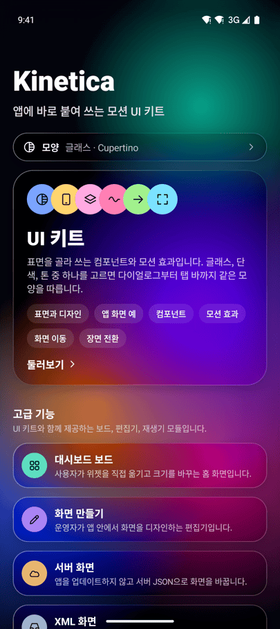<br><b>쇼케이스</b><br>모든 기능을 앱 하나에서 써 보기</td>
    <td align="center" width="33%">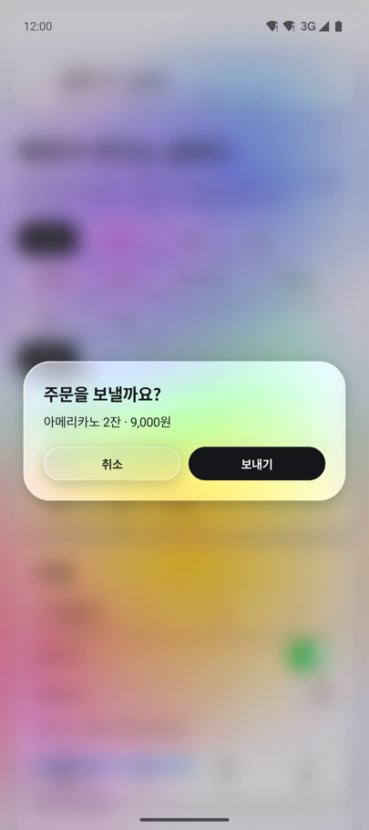<br><b>UI 키트</b><br>글래스, 단색, 톤 표면으로 바꿔 보는 다이얼로그, 시트, 탭 바</td>
    <td align="center" width="33%">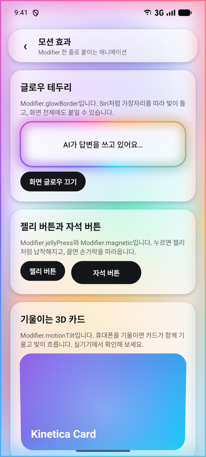<br><b>모션 효과</b><br>글로우 테두리, 젤리, 자석, 숫자 롤링, 컨페티</td>
  </tr>
  <tr>
    <td align="center" width="33%">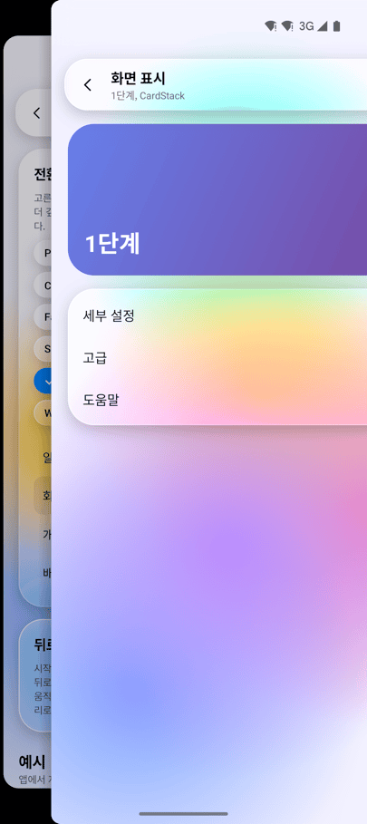<br><b>화면 이동</b><br>카드가 커지는 상세, 끌어서 닫기, iOS식 밀어 넣기</td>
    <td align="center" width="33%">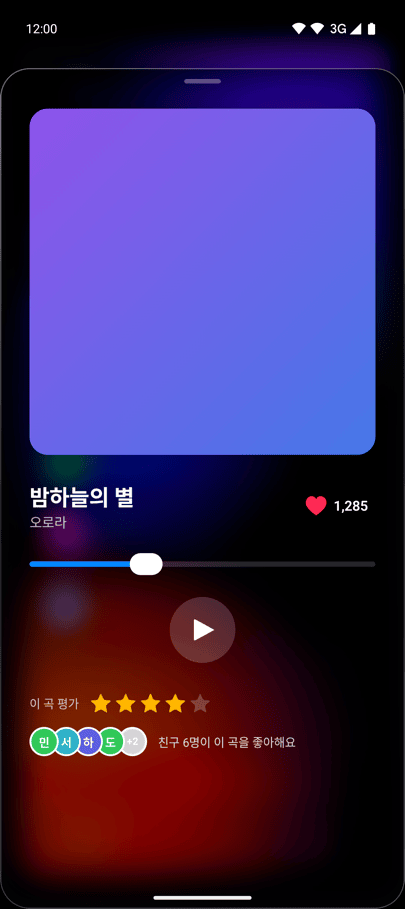<br><b>앱 화면 예</b><br>미니 플레이어, 지도 시트, 메일, 건강 차트</td>
    <td align="center" width="33%">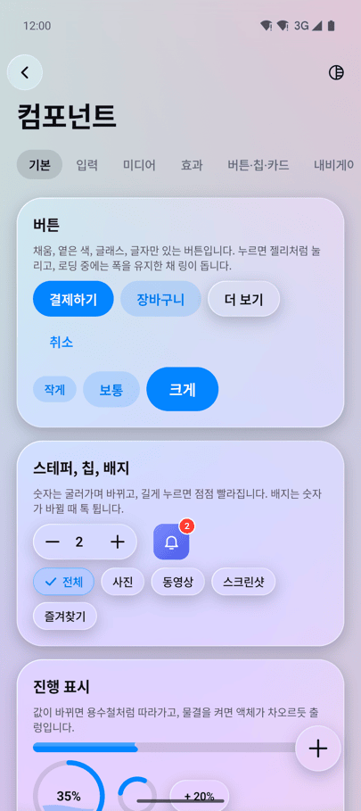<br><b>컴포넌트</b><br>버튼, 휠 피커, 카드 더미, 아일랜드 알림 등</td>
  </tr>
  <tr>
    <td align="center" width="33%">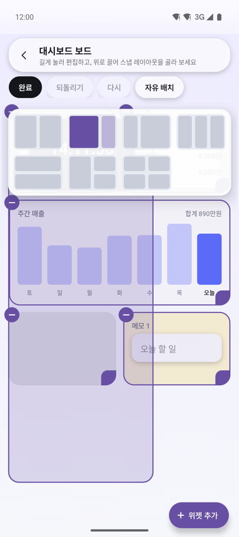<br><b>대시보드 보드</b><br>위로 끌면 Windows식 스냅 레이아웃</td>
    <td align="center" width="33%">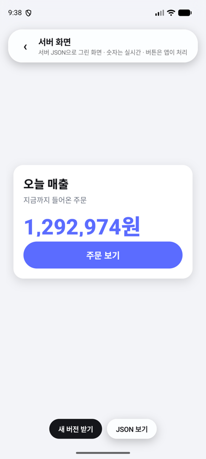<br><b>서버 화면</b><br>JSON만 바꿔 화면 교체, 숫자는 실시간 갱신</td>
    <td align="center" width="33%">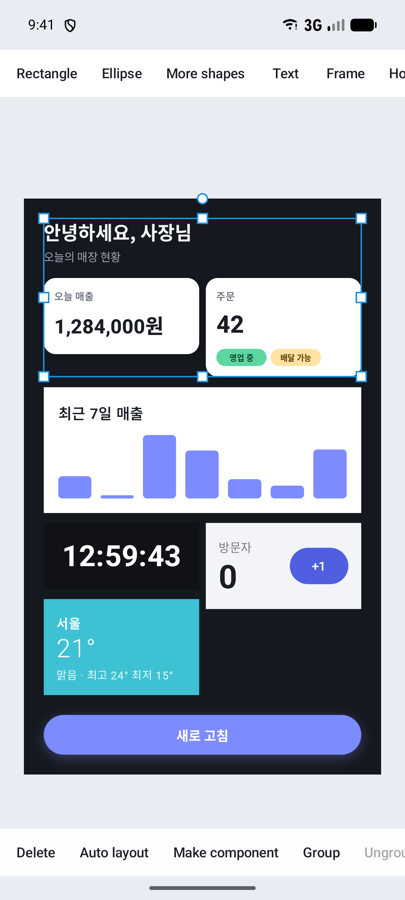<br><b>화면 만들기</b><br>앱 안에서 쓰는 Figma 같은 편집기. 여러 개를 함께 변형</td>
  </tr>
</table>

위 이미지는 `sample-showcase`를 Android 에뮬레이터에서 실행해 찍은 실제 화면입니다. 샘플 앱 하나에 데모 아홉 가지와 XML 화면 예가 들어 있습니다.

### 폴더블·태블릿

폭이 넓은 화면에서는 첫 화면이 두 칸으로 나뉘고, 메일 예는 목록과 본문을 나란히 보여 줍니다. 전체 화면 플레이어는 앨범 아트와 재생 조작부를 옆으로 놓고, 보드의 격자 배치는 칸 폭을 160dp 이상으로 유지하면서 열을 최대 6개까지 늘립니다. 아래는 Pixel 9 Pro Fold 에뮬레이터를 펼친 상태로 찍은 화면입니다.

<table>
  <tr>
    <td align="center" width="50%">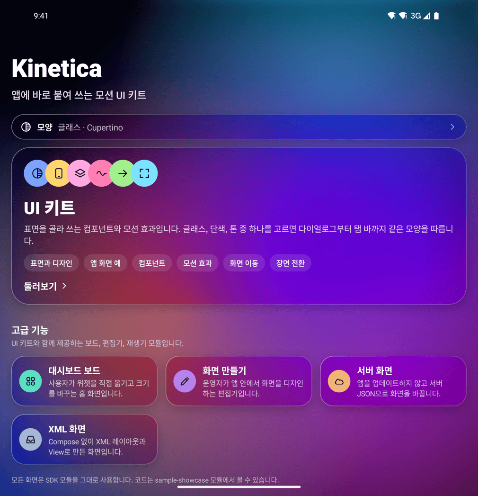<br><b>쇼케이스</b><br>두 칸으로 나뉜 데모 목록</td>
    <td align="center" width="50%"><br><b>메일</b><br>왼쪽에 목록, 오른쪽에 본문</td>
  </tr>
  <tr>
    <td align="center" width="50%"><br><b>음악 플레이어</b><br>앨범 아트와 조작부를 나란히</td>
    <td align="center" width="50%">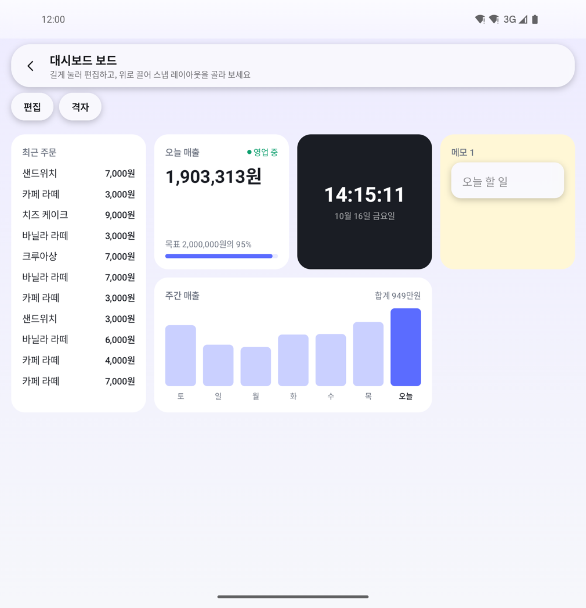<br><b>대시보드 보드</b><br>폭에 맞춰 4열로 늘어난 격자</td>
  </tr>
</table>

## 샘플 앱 내려받기

소스를 받지 않고도 기능을 직접 써 볼 수 있도록 샘플 앱(APK)을 [Releases](https://github.com/Naury74/Kinetica-Kit-SDK/releases/latest)에 올려 둡니다.

- [샘플 앱 내려받기 (kinetica-showcase.apk)](https://github.com/Naury74/Kinetica-Kit-SDK/releases/latest/download/kinetica-showcase.apk)
- Android 8.0(API 26) 이상에서 설치할 수 있습니다. 처음 설치할 때 "출처를 알 수 없는 앱" 설치를 허용해야 합니다.
- 체험용 키로 서명한 앱입니다. 새 버전이 기존 앱 위에 설치되지 않으면 기존 샘플 앱을 지운 뒤 다시 설치하세요.
- 글래스 표면의 블러는 Android 12 이상에서만 보입니다. 단색과 톤 표면은 모든 버전에서 같게 보입니다.

## 지금 되는 것 (1.0.0-alpha01)

- **디자인** ([docs/32](docs/32-studio.md))
  - 도형: 사각형, 타원, 다각형, 별, 선, 화살표
  - 채우기: 단색, 선형·원형 그라디언트
  - 효과: 바깥·안쪽 그림자 여러 개(퍼짐 포함), 레이어 블러, 점선, 모서리별 반지름
  - 리치 텍스트: 구간마다 굵기, 기울임, 밑줄, 크기, 색, 글꼴을 따로 지정할 수 있고 호스트 앱의 글꼴도 쓸 수 있습니다.
  - 기기 프레임을 씌운 목업 PNG
- **오토 레이아웃과 화면 크기 대응**
  - Frame을 가로나 세로로 자동 배치합니다. 간격, 여백, 정렬, 늘이기, 내용에 맞추기, 남는 공간 채우기, 줄 바꿈을 지원합니다.
  - 최소·최대 크기를 정할 수 있고, 텍스트 상자의 높이나 너비를 글자에 맞춰 자동으로 조절합니다.
  - 오토 레이아웃 안에서 끌어서 순서를 바꾸거나, 선택한 노드를 오토 레이아웃으로 감쌀 수 있습니다.
  - 노드 제약(왼쪽, 오른쪽, 좌우, 가운데, 비율)을 지원합니다.
  - 재생기에서 `SceneFit.Responsive`를 쓰면 기기 화면 비율에 맞춰 장면을 펼쳐 보여 줍니다.
- **컴포넌트와 디자인 토큰**
  - Frame을 컴포넌트로 만들어 인스턴스를 넣으면, 원본을 고칠 때 인스턴스도 함께 바뀝니다. 인스턴스에서 바꾼 값은 유지되고, 되돌리거나 원본과 분리할 수도 있습니다.
  - 채우기와 선을 색 토큰에 연결해 두면 토큰 하나만 바꿔 전체 색을 바꿀 수 있습니다.
  - 변형(variant)은 `세트/변형` 형식의 이름으로 만들고, 인스턴스에서 고르거나 호스트 데이터로 선택합니다.
  - 기본 키트: 버튼 세트, 칩, 카드, 토글, 입력 필드, 목록 항목, 탭 바
- **모션 효과** ([docs/33](docs/33-effects.md))
  - 호스트의 Compose 뷰(`Modifier.kineticaEffects`), XML View(`ViewEffects.apply`), 장면 노드, 보드 위젯에 코드 한 줄로 붙일 수 있습니다.
  - 누름 효과: 리플, 작아졌다 튕겨 돌아오기, 기울기, 어둡게, 떠오르기, 터지기
  - 등장 애니메이션 9종, 반복 애니메이션 11종(두근거림, 둥실 떠다니기, 반짝임, 글로우 번짐, 하트비트, 퍼지는 링 등)과 프리셋 모음 `EffectPresets`
  - 화면 전환 `ContentTransitions`, 숫자가 올라가는 애니메이션 `animateNumberAsState`
  - 클릭 이벤트를 가로채지 않고, 시스템의 "애니메이션 삭제" 설정을 따릅니다.
- **서버 주도 화면**
  - 호스트가 받아 온 장면 JSON을 로컬 문서와 같은 검증을 거쳐 읽고 재생합니다(`RemoteSceneLoader`, `RemoteKineticaPlayer`).
  - 캐시, 앱에 넣어 둔 기본 문서, 앱을 다시 켜도 유지되는 etag, 서명 확인(`SceneVerifier`), 여러 화면을 묶은 번들(`RemoteSceneBundleLoader`)을 지원합니다.
  - 받기에 실패하거나 호스트가 문서를 거절하면 지금 화면을 그대로 둡니다.
  - 배치가 바뀌어도 호스트 뷰의 상태와 데이터, 동작은 그대로 이어집니다.
- **호스트 UI 조립**
  - 호스트 뷰 슬롯(HostSlot), 모서리와 자르기를 지원하는 Frame, 그림자, 글자 굵기
  - 데이터 바인딩(텍스트, 표시 여부, 이미지, 채우기, 불투명도)과 탭 동작
  - 노드마다 실제 Compose 요소로 그리는 `SceneLayout`
  - 텍스트를 두 번 눌러 그 자리에서 바로 고치기
- **문서 모델**
  - 노드 종류: 그룹, Frame, 사각형, 타원, 다각형, 경로, 텍스트, 이미지, 호스트 뷰
  - 문서는 불변이고 명령으로만 수정합니다. 수정 결과는 매번 검증합니다(id, 순환, 깊이, 유한한 숫자, 상한, URI).
- **편집**
  - 선택, 이동, 크기 조절, 회전. 회전했거나 중첩된 노드에서도 반대쪽 핸들은 제자리에 고정됩니다.
  - 사각형 영역 선택, 두 손가락 이동과 확대
  - 가이드라인 스냅(8dp/12dp hysteresis)
  - 그룹 만들기와 해제(화면 위치 유지), 정렬과 분배, 쌓는 순서 변경
  - 속성 패널, 레이어 패널, 키보드 단축키
- **실행 취소**: 제스처 하나를 한 단계로 기록합니다. 바뀐 노드만 저장하며, 단계 수와 메모리에 상한이 있습니다.
- **애니메이션**
  - keyframe 속성: 이동, 배율, 회전, 불투명도, 색, 선 두께, 너비, 높이, 모서리 반지름(모서리별 포함), 선 색, 블러, 그림자(블러, X, Y, 퍼짐, 색), 그라디언트 색과 각도
  - easing: Bezier, steps(CSS와 같은 점프 방식 네 가지), 스프링. 회전은 키마다 방향(가장 짧게, 시계, 반시계, 값 그대로)을 정할 수 있습니다.
  - 시계 기준 재생: 배속, 반복, 왕복, 역방향, marker, "애니메이션 삭제" 설정 반영
  - timeline 편집 화면, 재생 위치에 키를 자동으로 추가, 프리셋 6종
  - timeline 확대(두 손가락, Ctrl+휠, 버튼, 맞춤)와 재생 위치 따라가기, 여러 키를 골라 함께 끌기·복사·붙여넣기·삭제, easing 곡선 편집기
- **전환**
  - 장면 morph: 같은 종류의 노드는 보간하고 다른 종류는 dissolve로 바꿉니다.
  - 끌어서 닫기: 손을 뗄 때의 속도를 반영하고, 끝났다는 콜백은 한 번만 옵니다.
  - Compose `sharedBounds`와 연결
- **이미지**: 사진 선택기로 고른 `content://` 이미지를 크기를 제한해 읽는 기본 로더가 있습니다. 호스트가 직접 로더를 넘길 수도 있습니다.
- **저장과 내보내기**
  - 스키마 버전이 있는 JSON. 크기와 중첩 깊이에 상한이 있고 migration 구조를 갖추고 있습니다.
  - 원자적으로 파일을 바꿔 쓰는 파일 저장소
  - 화면과 같은 그리기 코드로 만드는 PNG 내보내기
- **샘플**: 샘플 앱은 `sample-showcase` 하나입니다. 첫 화면에서 표면 스타일(글래스, 단색, 톤)과 밝기를 고르고, UI 키트, 모션 효과, 대시보드 보드, 앱 화면 예, 컴포넌트, 화면 이동, 장면 전환, 서버 화면, 화면 만들기(편집기)를 고를 수 있고, 맨 아래에서 Compose를 쓰지 않는 XML 화면 예를 열 수 있습니다.

아직 없는 기능과 제한 사항은 [알려진 제한](#알려진-제한)을 보세요.

## 요구 사항

- minSdk 26, Java 17이 필요합니다. 라이브러리는 compileSdk 37, Kotlin 2.4, Compose BOM 2026.09, AGP 9.4로 빌드합니다.
  호스트 앱은 Kotlin 2.2 이상이면 됩니다. 배포할 때 언어·API 버전과 `kotlin-stdlib` 의존성을 2.2에 맞춰 두었습니다. Compose는 같은 BOM 이상을 권장합니다.
- 보드, 재생기, 편집기는 Compose로 만들어졌습니다. XML View 화면에서는 `KineticaBoardView`와 `ViewEffects`를 쓰면 Compose 코드 없이 쓸 수 있습니다. 다만 앱에 Compose 런타임은 포함됩니다.
- 스레드: 상태 객체(`KineticaBoardState`, `KineticaSession`)는 메인 스레드에서 다룹니다. `RemoteSceneLoader`와 `SceneRepository`는 suspend 함수라서 어느 스레드에서 호출해도 됩니다.

## 연동

처음 쓴다면 [빠른 시작(docs/36)](docs/36-quick-start.md)부터 보세요. 의존성, 테마 맞추기, 자주 쓰는 10가지 예, 테스트하는 법이 있습니다.

Maven Central에서 받습니다. 좌표는 `com.naurylab:<모듈>:1.0.0-alpha01`이고 모든 모듈의 버전이 같습니다. 필요한 모듈만 넣으세요.

```kotlin
// settings.gradle.kts
dependencyResolutionManagement {
    repositories {
        google()
        mavenCentral()
    }
}

// app/build.gradle.kts
dependencies {
    implementation("com.naurylab:kinetica-ui:1.0.0-alpha01")              // UI 키트(글래스, 단색, 톤 표면), 다이얼로그, 시트, 탭 바, 고급 효과
    implementation("com.naurylab:kinetica-board-compose:1.0.0-alpha01")    // 호스트 위젯을 자유롭게 배치하는 대시보드 보드
    implementation("com.naurylab:kinetica-render-compose:1.0.0-alpha01")   // 모션 효과, 화면 전환, 숫자 애니메이션만 쓸 때
    implementation("com.naurylab:kinetica-presets:1.0.0-alpha01")          // EffectPresets, UiKit (선택)
    implementation("com.naurylab:kinetica-player-compose:1.0.0-alpha01")   // 장면 재생, 서버 화면
    implementation("com.naurylab:kinetica-editor-compose:1.0.0-alpha01")   // 편집 화면 (선택)
    implementation("com.naurylab:kinetica-serialization:1.0.0-alpha01")    // JSON, 파일 저장 (선택)
    implementation("com.naurylab:kinetica-export-android:1.0.0-alpha01")   // PNG 내보내기 (선택)
}
```

보드 (사용자가 호스트 위젯을 배치):

```kotlin
val catalog = listOf(BoardWidget("sales", "오늘 매출", widthDp = 176f, heightDp = 120f), BoardWidget("orders", "최근 주문"))

setContent {
    // 화면을 회전해도 배치와 실행 취소 기록이 남고, 화면이 가려질 때마다 저장된다.
    val board = rememberKineticaBoardState(catalog, BoardStorage.sharedPreferences(this, "home", "board"))
    var editing by rememberSaveable { mutableStateOf(false) }
    KineticaBoard(board, Modifier.fillMaxSize(), editing = editing, onLongPress = { editing = true }) { id ->
        when (board.widgetKeyOf(id)) {
            "sales" -> SalesCard()     // 호스트의 Composable을 그대로 쓴다
            "orders" -> OrdersCard()
        }
    }
}
```

재생기:

```kotlin
val box = SceneNode(NodeId("box"), NodeContent.Rectangle(Size(400.0, 400.0)), style = NodeStyle(fill = ArgbColor(0xFF7C8CFF.toInt())))
val fade = Timeline("main", 1_000, listOf(PropertyTrack(box.id, AnimatableProperty.Opacity,
    listOf(Keyframe(0, KeyValue.Scalar(0.0)), Keyframe(1_000, KeyValue.Scalar(1.0))))))
val scene = SceneDocument("hello", Artboard(1080.0, 1920.0), mapOf(box.id to box), listOf(box.id), listOf(fade))

setContent {
    val playback = rememberPlaybackController(fade)
    LaunchedEffect(playback) { playback.play() }   // 재구성할 때마다 호출되지 않도록 effect 안에서 시작한다
    KineticaPlayer(scene, Modifier.fillMaxSize(), playback)
}
```

편집기와 저장:

```kotlin
val repository = FileSceneRepository(File(filesDir, "scenes"))

lifecycleScope.launch {   // load는 suspend 함수다
    val document = (repository.load("studio") as? LoadResult.Loaded)?.document ?: SceneDocument.empty(Artboard(1080.0, 1920.0))
    val session = (KineticaSession.create(document) as SessionOpenResult.Opened).session
    setContent {
        val scope = rememberCoroutineScope()
        KineticaEditor(session, Modifier.fillMaxSize(), toolbarEnd = {
            TextButton(onClick = { scope.launch { repository.save("studio", session.document.value) } }) { Text("저장") }
        })
    }
}
```

호스트 뷰와 실시간 데이터:

```kotlin
val slots: SceneSlots = mapOf("widget.sales_chart" to { SalesChart(sales) })   // 호스트의 Composable을 그대로 쓴다
val hostViews = listOf(HostViewOption("widget.sales_chart", "매출 그래프", 900.0, 360.0))
val data = SceneData.of("sales.today" to DataValue.Text("1,284,000원"))           // 텍스트 노드의 Text 바인딩 키

KineticaEditor(session, slots = slots, hostViews = hostViews, data = data)        // 운영자나 사용자가 배치한다
KineticaPlayer(document, slots = slots, data = data, fit = SceneFit.Responsive, onAction = { action -> /* "refresh" 등 */ })
```

서버 화면 JSON 형식은 [docs/34](docs/34-scene-json.md)에 있습니다. OkHttp와 ETag로 문서를 받는 방법과 XML 재생기는 [docs/integration.md](docs/integration.md)에서 설명합니다.

세션은 화면을 회전해도 유지되도록 ViewModel에 두고, 화면을 닫을 때 `session.close()`를 호출하세요. View 기반 화면, Java, 내보내기, 전환은 [docs/integration.md](docs/integration.md)를 보세요.

## 모듈

| 모듈 | 종류 | 내용 |
| --- | --- | --- |
| `kinetica-core` | Kotlin JVM | 장면 문서와 노드, 행렬과 viewport, 명령과 reducer, 검증, hit test, 변형 계산 |
| `kinetica-history` | Kotlin JVM | `KineticaSession`, 트랜잭션, 실행 취소 |
| `kinetica-motion` | Kotlin JVM | keyframe 평가, easing, 재생 제어, 장면 morph, 전환 진행률 |
| `kinetica-guides` | Kotlin JVM | 가이드라인 스냅 |
| `kinetica-presets` | Kotlin JVM | 모션 프리셋, 기본 컴포넌트 키트(`UiKit`), 모션 효과 프리셋(`EffectPresets`) |
| `kinetica-serialization` | Kotlin JVM | JSON 읽기·쓰기, migration, 파일 저장소, 서버 문서 받기(`RemoteSceneLoader`) |
| `kinetica-java` | Kotlin JVM | Java 호스트용 정적 진입점 (선택) |
| `kinetica-render-compose` | Android | 장면 그리기(`SceneLayout`, `drawScene`), 모션 효과(`Modifier.kineticaEffects`, `ViewEffects`) |
| `kinetica-gestures` | Android | 캔버스 포인터 상태 기계 |
| `kinetica-editor-compose` | Android | `KineticaEditor` |
| `kinetica-player-compose` | Android | `KineticaPlayer`, `RemoteKineticaPlayer`, 전환 그리기, 끌어서 닫기 |
| `kinetica-board-compose` | Android | 위젯 보드 `KineticaBoard`, `KineticaBoardView` |
| `kinetica-export-android` | Android | PNG 내보내기 |
| `kinetica-ui` | Android | UI 키트(`KineticaScaffold`, 다이얼로그, 시트, 컨트롤, 전환)와 고급 효과. 표면은 글래스, 단색, 톤 중에서 고릅니다. 다른 Kinetica 모듈 없이 단독으로 쓸 수 있습니다 |

모듈 간 의존 방향, 데이터 흐름, 좌표계는 [docs/architecture.md](docs/architecture.md)에 정리되어 있습니다. 기능을 하나씩 확인해 보는 순서는 [docs/evaluation.md](docs/evaluation.md)를 보세요.

## 보안과 개인정보

- SDK에는 네트워크 권한이 없고, 문서나 이미지, 사용 기록을 외부로 보내지 않습니다. 서버 화면을 받는 일도 호스트의 `SceneFetcher`가 맡고, SDK는 받은 바이트를 검증하기만 합니다. 문서 안의 동작, 데이터, 호스트 뷰 키는 이름일 뿐이고 코드를 실행하지 않습니다.
- 외부에서 받은 문서는 크기(기본 10 MiB), JSON 중첩 깊이(64단계), 노드 수, 텍스트 길이, keyframe 수, 유한한 숫자인지, URI scheme을 모두 확인한 뒤에야 문서로 만들어집니다. 실패하면 예외를 던지지 않고 이유를 돌려주며, 그 이유에 사용자가 입력한 텍스트는 담지 않습니다.
- 이미지 노드는 기본적으로 `content://`와 `android.resource://`만 허용하고, SDK가 직접 열지 않습니다. 호스트가 `SceneImageProvider`로 미리 읽어 둔 이미지를 넘겨줍니다.

자세한 정책은 [SECURITY.md](SECURITY.md)에 있습니다.

## 성능

JVM(Apple M5) 기준으로 노드 2,000개에서 명령 적용은 p95 약 0.4 ms, timeline 평가는 약 0.14 ms 걸립니다. 실기기(Galaxy Z Fold7 커버 화면, 120Hz, release 빌드)에서는 보드 스크롤 프레임이 p50 5 ms, p90 7 ms였고, 편집 중 끌기에서 놓친 프레임은 6~9%였습니다. 측정 방법과 전체 결과는 [docs/performance.md](docs/performance.md)에 있습니다.

## 알려진 제한

- API 26 에뮬레이터(Android 8.0)와 Android 16 실기기(Galaxy Z Fold7)에서 확인했고, API 27 실기기는 확인하지 않았습니다.
- 이미지는 `content://`와 `android.resource://`만 읽고 웹 URL은 열지 않습니다. 웹 이미지는 호스트가 받아 둔 뒤 `content://`로 넘기거나 이미지 공급자를 직접 넘깁니다.
- 그룹은 자식을 잘라 내지 않습니다. 잘라 내려면 Frame을 씁니다.
- 숨긴 노드 안의 호스트 뷰는 상태를 지키려고 컴포지션에 남겨 두고 측정도 계속합니다. 무거운 호스트 뷰를 오래 숨겨 둔다면 `SceneLayout(hiddenSlots = HiddenSlotPolicy.Dispose)`로 빼 둘 수 있지만, 이때는 다시 보일 때 상태가 처음부터 시작됩니다.
- 캔버스에서는 최상위 노드 단위로 선택되며, 그룹 안의 노드는 레이어 패널에서 고릅니다. 여러 노드를 함께 크기 조절할 때 회전한 노드는 문서 축 배율을 자기 축에 나눠 받으므로 모양이 조금 달라질 수 있습니다.
- timeline 패널에서 키 줄의 빈 곳을 세로로 끌면 스크롤되므로, 사각 선택은 가로로 끌거나 길게 눌러 선택 모드를 켠 뒤 끌어서 시작합니다.
- SVG·MP4 내보내기, 협업, 텍스트 shaping 세부 제어는 범위 밖입니다(docs 기준 v1.1 이후).
- 오른쪽에서 왼쪽으로 쓰는 언어(RTL): 보드는 배치, 끌기, 추가 버튼, 삭제 버튼, 크기 핸들까지 좌우를 뒤집습니다. 장면(`SceneLayout`) 좌표는 디자인한 그대로 두고 뒤집지 않습니다.
- 기본으로 들어 있는 문구(편집기, 보드 안내)는 영어와 한국어만 있습니다. 다른 언어는 같은 이름의 문자열 리소스를 정의해 덮어쓰면 됩니다.
- Android 모듈의 공개 API dump는 AGP 9 내장 Kotlin의 제약 때문에 아직 없습니다([ADR-0005](docs/adr/0005-abi-dumps.md)).

## 빌드

```bash
export JAVA_HOME="/Applications/Android Studio.app/Contents/jbr/Contents/Home"
./gradlew check :sample-showcase:assembleDebug :sample-showcase:assembleRelease
```

`check`는 단위 테스트와 Robolectric 테스트, Android Lint, ktlint, detekt, 공개 API 검사(`checkKotlinAbi`), gallery release 런타임 검사(`verifyReleaseClasspath`)를 실행합니다.
Maven Central 배포 절차는 [docs/publishing.md](docs/publishing.md)에 있습니다. 배포된 artifact만으로 빌드되는지는 `./gradlew publishToMavenLocal && ./gradlew -p consumer-check :app:assembleRelease`로 확인합니다.
기여 방법은 [CONTRIBUTING.md](CONTRIBUTING.md), 변경 내역은 [CHANGELOG.md](CHANGELOG.md), 설계 결정은 [docs/adr](docs/adr)에 있습니다.

## 라이선스

[Apache License 2.0](LICENSE)
