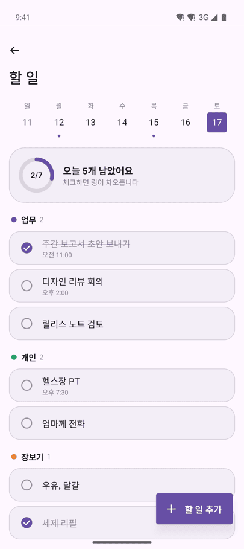
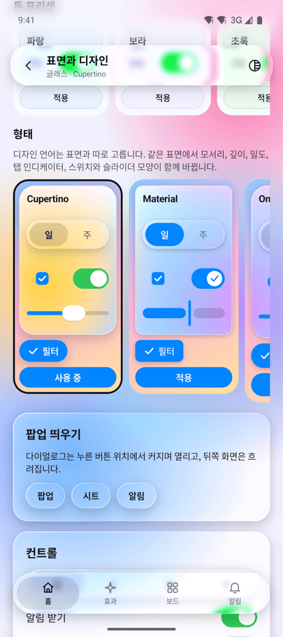
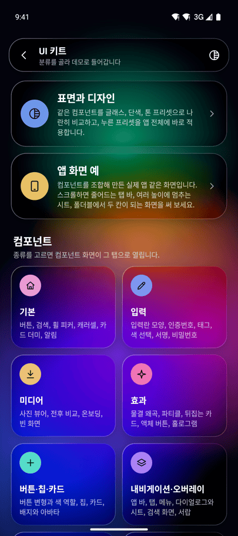
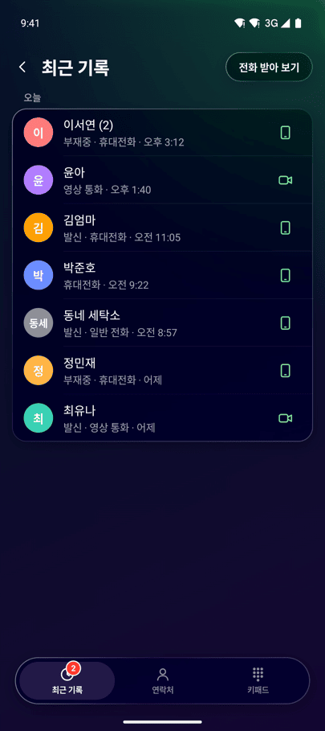
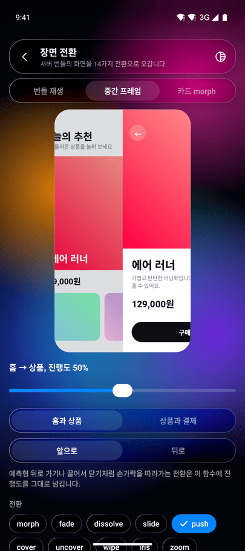

<p align="center">
  <picture>
    <source media="(prefers-color-scheme: dark)" srcset="docs/images/logo-dark.png">
    
  </picture>
</p>

<p align="center">
  
  <a href="LICENSE"></a>
</p>

**Kinetica**는 Jetpack Compose 앱에 쓰는 UI·모션 키트입니다.
버튼, 입력란, 다이얼로그, 바텀 시트, 토스트, 차트 같은 컴포넌트와 젤리 버튼, 글로우 테두리, 컨페티 같은 효과를 제공하고,
표면은 배경이 비치는 글래스, 깔끔한 단색, 브랜드 색을 옅게 섞은 톤 가운데에서 앱에 맞게 고릅니다.
사용자가 홈 화면 위젯을 직접 배치하는 보드와 앱 안 화면 편집기, 서버가 내려준 화면을 재생하는 기능도 함께 들어 있습니다.

> **알파 버전**: 1.0.0 정식 버전 전(`-alpha`, `-beta`)에는 공개 API가 바뀔 수 있습니다. 바뀐 내용은 [CHANGELOG.md](CHANGELOG.md)에 적습니다.

<table>
  <tr>
    <td align="center" width="33%"><br><b>글래스</b><br>배경이 블러로 비치는 표면</td>
    <td align="center" width="33%"><br><b>단색</b><br>같은 화면을 깔끔한 단색으로</td>
    <td align="center" width="33%"><br><b>톤</b><br>브랜드 색을 옅게 섞은 표면</td>
  </tr>
  <tr>
    <td align="center" width="33%"><br><b>Material 형태</b><br>행마다 떨어진 목록, 채운 인디케이터</td>
    <td align="center" width="33%"><br><b>Fluent 형태</b><br>작은 반지름, 그림자 대신 테두리</td>
    <td align="center" width="33%"><br><b>Brutal 형태</b><br>각진 모서리와 오프셋 그림자</td>
  </tr>
  <tr>
    <td align="center" width="33%"><br><b>표면과 디자인</b><br>같은 컴포넌트를 형태 6종으로 비교</td>
    <td align="center" width="33%"><br><b>UI 키트</b><br>분류별로 데모에 들어가는 허브</td>
    <td align="center" width="33%"><br><b>앱 화면 예</b><br>전화, 메신저, 쇼핑, 송금 등 14개 앱</td>
  </tr>
  <tr>
    <td align="center" width="33%"><br><b>전화 앱</b><br>통화 기록, 키패드, 아일랜드, 영상 통화</td>
    <td align="center" width="33%"><br><b>화면 이동</b><br>전환 22종, 뒤로 가기는 되감기</td>
    <td align="center" width="33%"><br><b>장면 전환</b><br>서버 장면 사이 전환 14종</td>
  </tr>
</table>

모두 `sample-showcase`를 Android 에뮬레이터에서 실행해 찍은 화면입니다. 첫 줄은 같은 앱 화면을 표면 스타일만 바꿔, 둘째 줄은 단색 표면에서 형태(디자인 언어)만 바꿔 찍었습니다. 폴더블과 태블릿 화면, 편집기, 서버 화면은 [쇼케이스 화면 더 보기](#쇼케이스-화면-더-보기)에 있습니다.

## 빠른 시작

```kotlin
// app/build.gradle.kts (저장소는 google(), mavenCentral())
dependencies {
    implementation("com.naurylab:kinetica-ui:1.0.0-alpha01")
}
```

화면 루트를 `KineticaTheme`으로 감싸고 표면 스타일을 고른 뒤, 컴포넌트를 씁니다.

```kotlin
setContent {
    val dark = isSystemInDarkTheme()
    KineticaTheme(
        // 단색 표면. 글래스는 SurfaceStyles.Liquid, 톤은 SurfaceStyles.tonal(brandColor)
        surface = if (dark) SurfaceStyles.CleanDark else SurfaceStyles.CleanLight,
        colors = KineticaColors(accent = Color(0xFF3B5BDB)),
    ) {
        var sharing by remember { mutableStateOf(false) }
        KineticaScaffold { padding ->
            Column(Modifier.padding(padding).padding(24.dp)) {
                KButton("공유하기", onClick = { sharing = true }, fullWidth = true)
            }
            KSheet(sharing, onDismissRequest = { sharing = false }) {
                KListItem("링크 복사", onClick = { sharing = false })
                KListItem("메시지로 보내기", onClick = { sharing = false })
            }
        }
    }
}
```

표면 스타일은 앱 전체에 하나를 정하고, 필요하면 컴포넌트마다 `surface` 파라미터로 바꿉니다.

| 원하는 모양 | `surface` 값 | 블러 |
| --- | --- | --- |
| 배경이 비치는 글래스 | `SurfaceStyles.Liquid`, `LiquidDark`, `Acrylic`, `OneUiGlass`, `Vision`, `Frosted`, `Mica` 등 15종 | Android 12 이상에서 그림. 그 아래는 반투명 색 |
| 깔끔한 단색 | `SurfaceStyles.CleanLight`, `CleanDark`, `OneUi`, `OneUiDark`, `Material`, `MaterialDark` 또는 `SurfaceStyle.Solid(…)` | 없음. 모든 버전에서 같게 보임 |
| 브랜드 색을 옅게 섞은 톤 | `SurfaceStyles.tonal(brandColor, dark)`, `Tonal`, `TonalDark` | 없음 |

버튼과 칩, 카드는 표면과 따로 모양(`KVariant`: `Filled`, `Tonal`, `Outlined`, `Text`, `Elevated`, `Glass`)과 색 역할(`KTone`: `Accent`, `Neutral`, `Destructive`, `Positive`)을 고를 수 있습니다.
Material 3 앱이라면 `MaterialTheme` 안쪽에 `KineticaTheme`을 두고 강조색과 글꼴을 넘기면 됩니다. 자세한 순서는 [빠른 시작 문서](docs/36-quick-start.md)에 있습니다.

## 무엇이 들어 있나

### UI 키트 (`kinetica-ui`)

컴포넌트와 효과가 200여 개 들어 있습니다. 전체 목록과 예는 [docs/35 UI 키트](docs/35-ui-kit.md)에 있습니다.

| 분류 | 예 |
| --- | --- |
| [버튼, 입력, 선택](docs/35-ui-kit.md#버튼-입력-선택) | 로딩과 성공 표시가 있는 버튼, 버튼 묶음, 칩, 스위치, 세그먼트, 슬라이더, 떠오르는 라벨 입력란, 인증번호, 태그, 비밀번호, 금액 입력, 휠 피커, 달력, 색 선택기, 서명란 |
| [목록과 카드](docs/35-ui-kit.md#목록과-카드) | 설정 화면 행과 섹션, 밀어서 동작하는 행, 끌어서 순서 바꾸기, 아코디언, 카드, 캐러셀, 틴더식 카드 더미, 아바타, 배지 |
| [내비게이션과 앱 바](docs/35-ui-kit.md#내비게이션과-앱-바) | 상단 앱 바, 접히는 큰 제목, 떠 있는 탭 바, 상단 탭, 서랍, iOS식 push 전환, 카드가 커지며 열리는 상세 화면, 검색 화면, 마법사 |
| [오버레이](docs/35-ui-kit.md#오버레이) | 다이얼로그, 바텀 시트, 여러 높이에 멈추는 시트, 동작 시트, 전체 화면 모달, 드롭다운과 길게 눌러 여는 메뉴, 툴팁, 기능 안내 |
| [피드백과 로딩](docs/35-ui-kit.md#피드백과-로딩) | 토스트, 쌓이는 토스트, 되돌리기 스낵바, 다이내믹 아일랜드식 알림, 배너, 로딩 표시, 스켈레톤, 당겨서 새로 고침, 결과 표시, 빈 화면 |
| [데이터 표시](docs/35-ui-kit.md#데이터-표시) | 선, 막대, 영역, 도넛, 파이 차트, 히트맵, 게이지, 활동 링, 숫자 카드, 타임라인, 플립 시계, 요금제 카드 |
| [미디어와 소셜](docs/35-ui-kit.md#미디어와-소셜) | 미니 플레이어, 사진 뷰어, 전후 비교, 온보딩, 채팅 말풍선과 입력창, 스토리, 첨부 파일, 지도 핀 |
| [효과와 모션](docs/35-ui-kit.md#효과와-모션) | 글로우 테두리, 젤리 누름, 자석, 기기를 기울이면 따라 기우는 3D, 홀로그램, 물결 왜곡, 숫자 롤링, 타자기, 컨페티, 파티클, 메시 그라디언트 배경, 공유 요소 전환 |
| [넓은 화면과 폴더블](docs/35-ui-kit.md#넓은-화면과-폴더블) | 목록-상세 두 칸, 내비게이션 레일, 탁자 모드 배치, 창 크기 정보 |

컴포넌트는 TalkBack, 키보드 조작, 아랍어 같은 RTL 언어, 큰 글꼴에 맞춰 동작하고, 시스템의 '애니메이션 삭제' 설정이 켜져 있으면 움직임을 줄입니다.
`KineticaScaffold` 없이 호스트의 Material `Scaffold` 안에서 불러도 되고, XML 화면에서는 `KSheets`, `KDialogs`, `KToasts`, `KSurfaceView`로 씁니다.

### 모션 효과 (`kinetica-render-compose`, `kinetica-presets`)

`Modifier.kineticaEffects(EffectPresets.button)`처럼 수정자 하나로 리플, 축소, 떠오르기, 버스트 같은 누를 때 효과와 등장, 반복 애니메이션을 붙입니다.
XML View에는 `ViewEffects.apply`로 같은 효과를 붙이고, 화면 전환 `ContentTransitions`와 숫자 애니메이션 `animateNumberAsState`도 있습니다. [docs/33 모션 효과](docs/33-effects.md)

### 함께 제공하는 고급 기능

UI 키트와 따로 쓰는 모듈입니다. 필요한 것만 넣으면 됩니다.

- **위젯 보드** (`kinetica-board-compose`): 앱 사용자가 홈 화면의 위젯을 옮기고, 크기를 바꾸고, 빼거나 추가합니다. 위로 끌면 Windows 스냅 레이아웃처럼 배치를 고르고, 위젯을 겹쳐 스택으로 만들 수 있습니다. 배치는 저장되고, 펼친 폴더블이나 태블릿에서는 격자 열을 늘린 넓은 화면 배치를 따로 기억합니다. [docs/31](docs/31-board.md)
- **화면 편집기와 재생기** (`kinetica-editor-compose`, `kinetica-player-compose`): 운영자나 디자이너가 앱 안에서 Figma처럼 화면을 만들고, 호스트 앱의 실제 Compose 뷰와 실시간 데이터를 그 화면에 배치합니다. 키프레임 애니메이션과 장면 전환도 됩니다. [docs/30](docs/30-ui-composer.md), [docs/32](docs/32-studio.md)
- **서버 주도 화면** (`RemoteKineticaPlayer`): 서버가 내려준 JSON으로 앱 업데이트 없이 화면을 바꿉니다. 캐시, 서명 확인, 여러 화면 번들을 지원하고, 받기에 실패하면 지금 화면을 그대로 둡니다. [docs/34](docs/34-scene-json.md), [연동 예](docs/integration.md#서버-화면)

<details>
<summary>보드와 재생기 코드 예</summary>

보드 (사용자가 호스트 위젯을 배치):

```kotlin
val catalog = listOf(BoardWidget("sales", "오늘 매출", widthDp = 176f, heightDp = 120f), BoardWidget("orders", "최근 주문"))

setContent {
    // 화면을 회전해도 배치와 실행 취소 기록이 남고, 화면이 가려질 때마다 저장된다.
    val board = rememberKineticaBoardState(catalog, BoardStorage.sharedPreferences(this, "home", "board"))
    var editing by rememberSaveable { mutableStateOf(false) }
    KineticaBoard(board, Modifier.fillMaxSize(), editing = editing, onLongPress = { editing = true }) { id ->
        when (board.widgetKeyOf(id)) {
            "sales" -> SalesCard()     // 호스트의 Composable을 그대로 쓴다
            "orders" -> OrdersCard()
        }
    }
}
```

재생기:

```kotlin
val box = SceneNode(NodeId("box"), NodeContent.Rectangle(Size(400.0, 400.0)), style = NodeStyle(fill = ArgbColor(0xFF7C8CFF.toInt())))
val fade = Timeline("main", 1_000, listOf(PropertyTrack(box.id, AnimatableProperty.Opacity,
    listOf(Keyframe(0, KeyValue.Scalar(0.0)), Keyframe(1_000, KeyValue.Scalar(1.0))))))
val scene = SceneDocument("hello", Artboard(1080.0, 1920.0), mapOf(box.id to box), listOf(box.id), listOf(fade))

setContent {
    val playback = rememberPlaybackController(fade)
    LaunchedEffect(playback) { playback.play() }   // 재구성할 때마다 호출되지 않도록 effect 안에서 시작한다
    KineticaPlayer(scene, Modifier.fillMaxSize(), playback)
}
```

편집기와 저장, 호스트 뷰와 실시간 데이터, 서버 화면, XML 재생기, PNG 내보내기, Java 예는 [docs/integration.md](docs/integration.md)에 있습니다.

</details>

## 모듈

좌표는 `com.naurylab:<모듈>:1.0.0-alpha01`이고 모든 모듈의 버전이 같습니다. Maven Central에서 받습니다.

| 모듈 | 내용 |
| --- | --- |
| `kinetica-ui` | UI 키트와 효과. 다른 Kinetica 모듈 없이 단독으로 씁니다 |
| `kinetica-render-compose` | `Modifier.kineticaEffects`, `ViewEffects`, `ContentTransitions`, `animateNumberAsState` |
| `kinetica-presets` | 효과 프리셋 `EffectPresets`, 편집기 기본 키트 `UiKit`, 모션 프리셋 |
| `kinetica-board-compose` | 위젯 보드 `KineticaBoard`, XML용 `KineticaBoardView` |
| `kinetica-player-compose` | 장면 재생 `KineticaPlayer`, 서버 화면 `RemoteKineticaPlayer`, XML용 `KineticaPlayerView`, 장면 전환 |
| `kinetica-editor-compose` | 화면 편집기 `KineticaEditor` |
| `kinetica-serialization` | 장면 JSON, 파일 저장소, 서버 문서 받기 `RemoteSceneLoader` |
| `kinetica-export-android` | 장면을 PNG로 내보내기 |
| `kinetica-java` | Java 호스트용 정적 진입점 |
| `kinetica-core`, `kinetica-history`, `kinetica-motion`, `kinetica-guides`, `kinetica-gestures` | 위 모듈이 함께 가져오는 기반(문서 모델, 실행 취소, 키프레임, 스냅, 포인터 처리)입니다. gestures를 뺀 넷은 Android 없이 도는 Kotlin JVM 모듈이라 서버나 테스트에서도 쓸 수 있습니다 |

모듈 사이의 의존 방향은 [docs/architecture.md](docs/architecture.md)에 있습니다.

## 요구 사항

- minSdk 26(Android 8.0), Java 17. 호스트 앱은 Kotlin 2.2 이상이면 됩니다. Compose BOM은 2026.09 이상을 권장합니다.
- 라이브러리는 compileSdk 37, Kotlin 2.4, AGP 9.4로 빌드합니다.
- 글래스 표면의 블러는 Android 12(API 31) 이상에서 보입니다. 그보다 낮은 기기에서는 반투명 색으로 그립니다. 단색과 톤 표면은 모든 버전에서 같습니다.
- 물결 왜곡과 메시 그라디언트의 셰이더는 Android 13(API 33) 이상에서 쓰고, 그 아래에서는 비슷한 모양으로 대신 그립니다.
- `kinetica-ui`는 Material 3에 의존하지 않습니다. Material 3 앱과 함께 써도 됩니다.
- XML View 화면에서도 쓸 수 있지만 앱에 Compose 런타임은 포함됩니다.
- SDK는 네트워크 권한이 없고 아무것도 외부로 보내지 않습니다. 서버 화면도 호스트가 받아 온 바이트를 검증해 읽기만 합니다. 자세한 내용은 [SECURITY.md](SECURITY.md)에 있습니다.

## 샘플 앱

소스를 받지 않고도 써 볼 수 있도록 샘플 앱(APK)을 [Releases](https://github.com/Naury74/Kinetica-Kit-SDK/releases/latest)에 올려 둡니다.

- [샘플 앱 내려받기 (kinetica-showcase.apk)](https://github.com/Naury74/Kinetica-Kit-SDK/releases/latest/download/kinetica-showcase.apk)
- Android 8.0(API 26) 이상에서 설치할 수 있습니다. 처음 설치할 때 "출처를 알 수 없는 앱" 설치를 허용해야 합니다.
- 체험용 키로 서명한 앱입니다. 새 버전이 덮어 설치되지 않으면 기존 샘플 앱을 지운 뒤 다시 설치하세요.

첫 화면에서 가장 크게 보이는 **UI 키트**를 누르면 분류별 허브가 열립니다. 허브에는 표면과 디자인, 앱 화면 예, 컴포넌트(종류별 탭 아홉 개), 모션 효과, 화면 이동, 장면 전환이 있고, 컴포넌트 종류를 누르면 그 탭으로 바로 들어갑니다. 첫 화면 아래 **고급 기능**에서는 대시보드 보드, 화면 만들기 편집기, 서버 화면과 Compose 없이 만든 XML 화면을 열 수 있습니다.

표면 종류(글래스, 단색, 톤)와 프리셋, 밝기, 형태는 앱 전체에서 한 곳에서만 고릅니다. 모든 화면 상단 바의 모양 버튼이나 첫 화면의 모양 줄을 누르면 같은 시트가 열리고, 고른 값을 모든 데모가 따릅니다.

### 쇼케이스 화면 더 보기

<table>
  <tr>
    <td align="center" width="33%"><br><b>쇼케이스</b><br>UI 키트와 고급 기능으로 나뉜 첫 화면</td>
    <td align="center" width="33%"><br><b>서버 화면</b><br>JSON만 바꿔 화면 교체, 숫자는 실시간 갱신</td>
    <td align="center" width="33%"><br><b>화면 만들기</b><br>앱 안에서 쓰는 화면 편집기</td>
  </tr>
  <tr>
    <td align="center" width="33%"><br><b>위젯 보드</b><br>사용자가 직접 배치하는 홈 화면</td>
    <td align="center" width="33%"><br><b>컴포넌트</b><br>버튼부터 차트, 채팅까지 아홉 개 탭</td>
    <td align="center" width="33%"><br><b>모션 효과</b><br>글로우 테두리, 젤리, 자석, 숫자 롤링</td>
  </tr>
</table>

폭이 넓은 화면에서는 첫 화면의 고급 기능이 여러 칸으로 늘어나고, 메일 예는 목록과 본문을 나란히 보여 줍니다. 전체 화면 플레이어는 앨범 아트와 조작부를 옆으로 놓고, 보드의 격자는 칸 폭을 160dp 이상으로 유지하며 열을 최대 6개까지 늘립니다. 아래는 Pixel 9 Pro Fold 에뮬레이터를 펼친 상태로 찍었습니다.

<table>
  <tr>
    <td align="center" width="50%"><br><b>쇼케이스</b><br>UI 키트 카드와 고급 기능 세 칸</td>
    <td align="center" width="50%"><br><b>메일</b><br>왼쪽에 목록, 오른쪽에 본문</td>
  </tr>
  <tr>
    <td align="center" width="50%"><br><b>음악 플레이어</b><br>앨범 아트와 조작부를 나란히</td>
    <td align="center" width="50%"><br><b>위젯 보드</b><br>폭에 맞춰 4열로 늘어난 격자</td>
  </tr>
</table>

## 문서

| 문서 | 내용 |
| --- | --- |
| [36 빠른 시작](docs/36-quick-start.md) | 의존성, 테마 맞추기, 자주 쓰는 10가지, 흔한 실수, 테스트하는 법 |
| [35 UI 키트](docs/35-ui-kit.md) | 표면 스타일과 모든 컴포넌트, 호스트 앱에서 쓸 때 알아 둘 점, 성능 |
| [33 모션 효과](docs/33-effects.md) | `kineticaEffects`, `ViewEffects`, 프리셋, 화면 전환 |
| [31 위젯 보드](docs/31-board.md) | 보드 연동, 동작, 저장, 넓은 화면 |
| [30 UI 조립](docs/30-ui-composer.md) | 호스트 뷰 슬롯, 데이터 바인딩, 오토 레이아웃, 컴포넌트, 서버 화면 |
| [32 편집기](docs/32-studio.md) | 편집 기능, 도형과 스타일, 리치 텍스트, 타임라인 |
| [34 장면 JSON](docs/34-scene-json.md) | 서버 화면과 저장 파일의 형식 |
| [연동 예](docs/integration.md) | 편집 세션, 이미지, 서버 화면, XML 재생기, PNG 내보내기, 장면 전환, Java |
| [아키텍처](docs/architecture.md), [성능](docs/performance.md), [검증 가이드](docs/evaluation.md) | 모듈 구조와 좌표계, 측정값, 기능을 하나씩 확인하는 순서와 알려진 제한 |
| [배포](docs/publishing.md), [설계 결정(ADR)](docs/adr), [CONTRIBUTING](CONTRIBUTING.md), [CHANGELOG](CHANGELOG.md) | 관리자와 기여자용 |

## 빌드

```bash
export JAVA_HOME="/Applications/Android Studio.app/Contents/jbr/Contents/Home"
./gradlew check :sample-showcase:assembleDebug :sample-showcase:assembleRelease
```

`check`는 단위 테스트와 Robolectric 테스트, Android Lint, ktlint, detekt, 공개 API 검사(`checkKotlinAbi`), 재생기 런타임 의존성 검사(`verifyReleaseClasspath`)를 실행합니다.
배포된 artifact만으로 빌드되는지는 `./gradlew publishToMavenLocal && ./gradlew -p consumer-check :app:assembleRelease`로 확인합니다.

## 라이선스

[Apache License 2.0](LICENSE)
