<p align="center">
  <picture>
    <source media="(prefers-color-scheme: dark)" srcset="docs/images/logo-dark.png">
    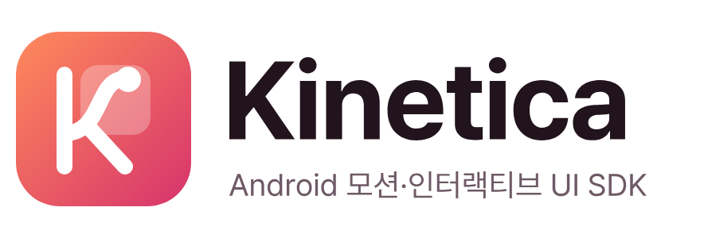
  </picture>
</p>

<p align="center">
  <a href="https://central.sonatype.com/artifact/com.naurylab/kinetica-ui"></a>
  
  <a href="LICENSE"></a>
</p>

**Kinetica**는 Jetpack Compose용 UI 키트입니다.
버튼과 다이얼로그 같은 기본 컴포넌트부터 차트, 채팅, 영상 통화 화면까지 200개가 넘는 컴포넌트를 담았고, 누르고 넘기고 화면을 옮기는 순간마다 자연스럽게 움직이도록 만들었습니다.

표면 스타일 하나만 고르면 앱 전체의 모양이 바뀝니다. 뒤가 비치는 글래스, 깔끔한 단색, 브랜드 색을 옅게 입힌 톤 가운데 앱에 맞는 것을 쓰면 됩니다.

<table>
  <tr>
    <td align="center" width="25%">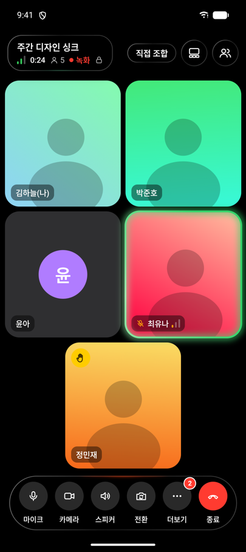<br><b>영상 통화</b><br>참가자 그리드와 컨트롤 바</td>
    <td align="center" width="25%">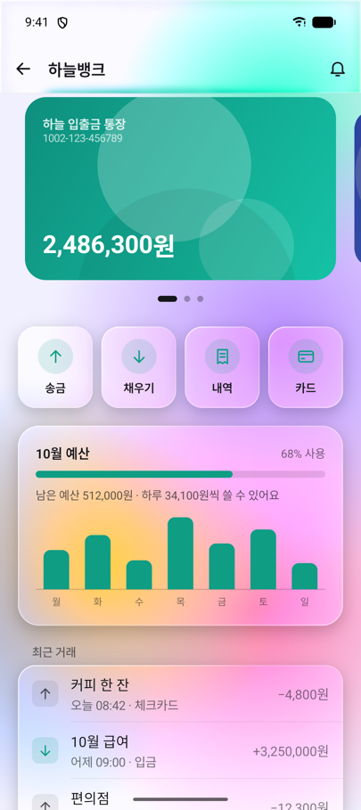<br><b>송금</b><br>카드 캐러셀과 예산 차트</td>
    <td align="center" width="25%">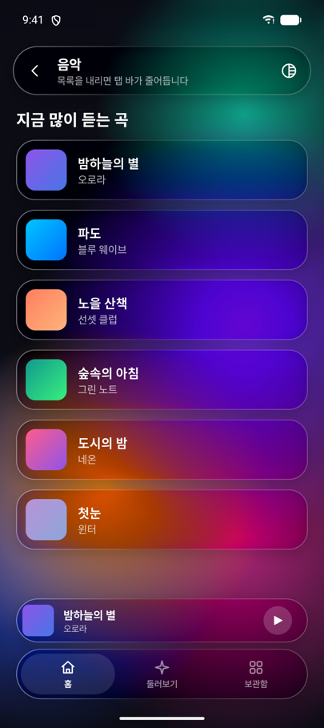<br><b>음악</b><br>추천 앨범과 미니 플레이어</td>
    <td align="center" width="25%">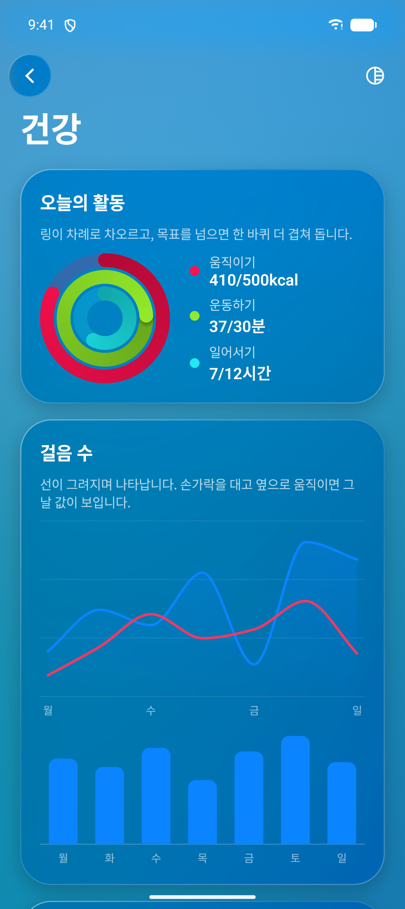<br><b>건강</b><br>활동 링과 그려지는 차트</td>
  </tr>
</table>

## 기능

- **컴포넌트**: 입력란과 휠 피커, 여러 높이에 멈추는 바텀 시트, 쌓이는 토스트, 다이내믹 아일랜드 알림, 차트, 사진 뷰어처럼 앱에서 자주 만드는 UI를 바로 씁니다.
- **표면 스타일**: 글래스 15종, 단색 6종, 브랜드 색으로 만드는 톤이 있습니다. 앱 전체에 하나를 정해 두고, 필요한 컴포넌트만 따로 바꿀 수도 있습니다.
- **디자인 언어**: Cupertino, Material, One UI, Fluent, Brutal, Soft 중 하나를 고르면 모서리, 그림자, 간격, 컨트롤 모양, 애니메이션 속도가 함께 바뀝니다.
- **모션**: 젤리처럼 눌리는 버튼, 글로우 테두리, 기기를 기울이면 따라 움직이는 3D 카드, 숫자 롤링, 컨페티를 수정자 하나로 붙입니다.
- **화면 전환**: 가장자리에서 밀어 뒤로 가는 push 내비게이션, 카드가 커지며 열리는 상세 화면, 공유 요소 전환까지 22가지 전환이 있습니다.
- **영상 통화 화면**: 참가자 그리드, 발표자 고정, 컨트롤 바, 반응 이모지, 걸려 오는 전화 화면을 `KCallScreen` 하나로 띄웁니다. 부품만 가져다 직접 조립해도 됩니다.
- **위젯 보드**: 사용자가 홈 화면 위젯을 옮기고, 크기를 바꾸고, 겹쳐서 스택으로 만듭니다. 배치는 저장됩니다.
- **화면 에디터와 서버 드리븐 UI**: 운영자가 앱 안에서 화면을 만들고 애니메이션을 붙입니다. 서버에서 JSON만 바꾸면 앱을 업데이트하지 않고도 화면이 바뀝니다.
- **접근성**: TalkBack, 키보드 조작, 아랍어 같은 RTL 언어, 큰 글꼴을 지원합니다. 시스템의 '애니메이션 삭제'를 켜면 움직임을 줄입니다.
- **폴더블과 태블릿**: 넓은 화면에서는 목록과 상세를 나란히 놓고, 접고 펼쳐도 하던 상태가 그대로 남습니다.
- **XML 화면**: Compose를 쓰지 않는 화면에서도 시트, 다이얼로그, 토스트, 글래스 표면을 쓸 수 있습니다.

## 화면

디자인 언어를 바꾸면 같은 컴포넌트가 이렇게 달라집니다.

<table>
  <tr>
    <td align="center" width="33%">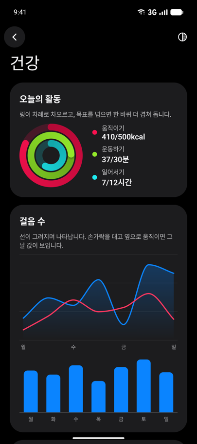<br><b>Material</b><br>건강 앱의 활동 링과 차트</td>
    <td align="center" width="33%">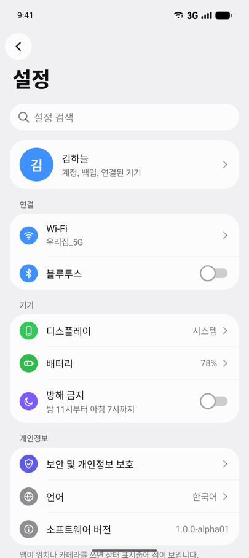<br><b>One UI</b><br>둥글게 묶인 설정 목록</td>
    <td align="center" width="33%">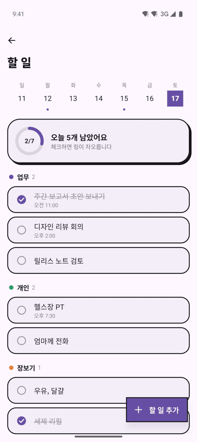<br><b>Brutal</b><br>각진 모서리와 굵은 그림자</td>
  </tr>
</table>

같은 화면을 표면 스타일만 바꿔 보면 이렇습니다.

<table>
  <tr>
    <td align="center" width="33%">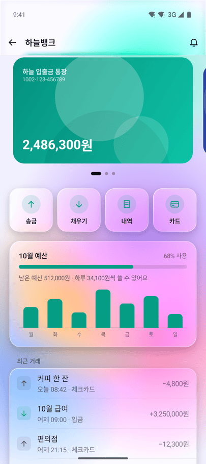<br><b>글래스</b><br>뒤 배경이 블러로 비칩니다</td>
    <td align="center" width="33%">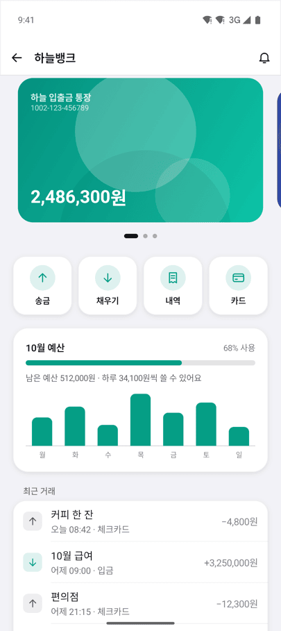<br><b>단색</b><br>같은 화면을 불투명한 면으로</td>
    <td align="center" width="33%">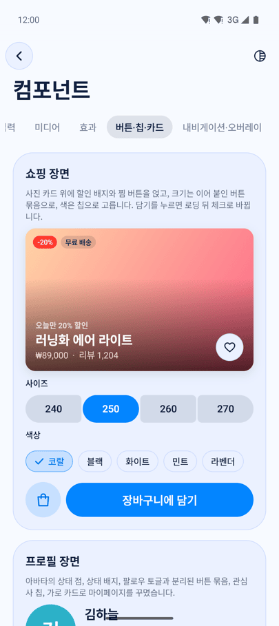<br><b>톤</b><br>브랜드 색을 옅게 입힌 면</td>
  </tr>
</table>

샘플 앱에 들어 있는 앱 예제 14개 가운데 일부입니다. 모두 Kinetica 컴포넌트만으로 만들었습니다.

<table>
  <tr>
    <td align="center" width="33%">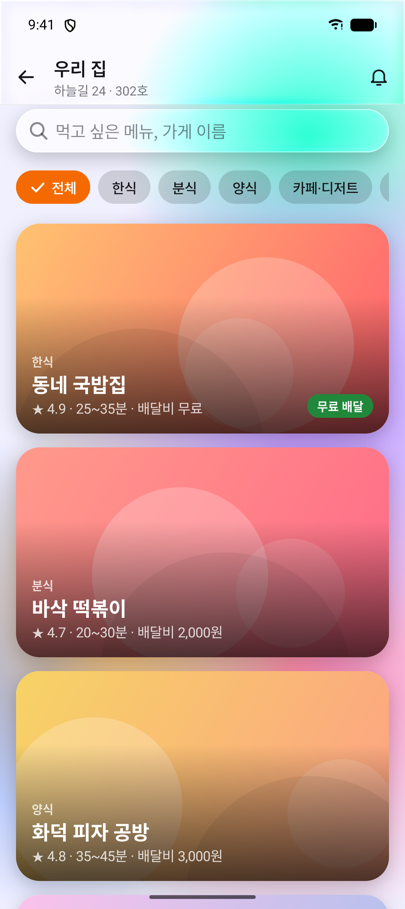<br><b>음식 배달</b><br>글래스 카드와 칩 필터</td>
    <td align="center" width="33%">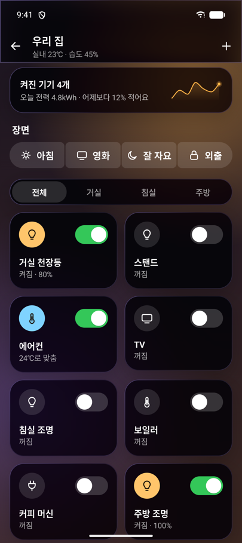<br><b>스마트 홈</b><br>어두운 표면의 기기 스위치</td>
    <td align="center" width="33%">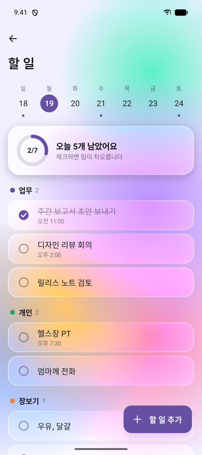<br><b>할 일</b><br>주간 달력과 진행 링</td>
  </tr>
  <tr>
    <td align="center" width="33%">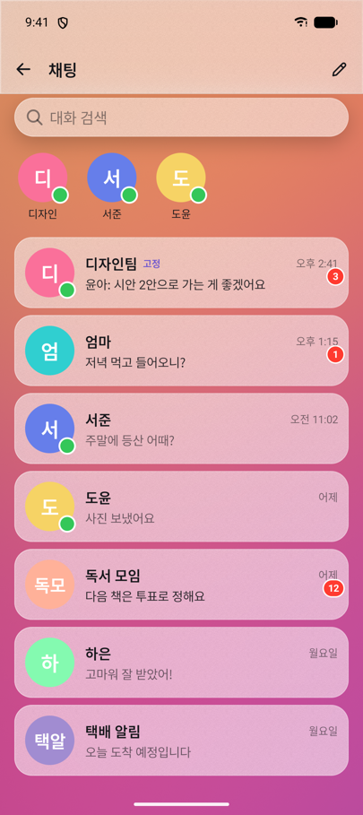<br><b>메신저</b><br>스토리 링과 대화 목록</td>
    <td align="center" width="33%">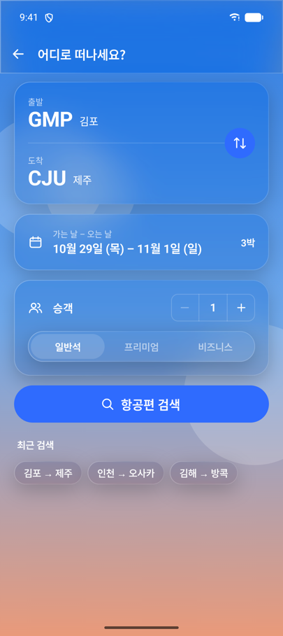<br><b>여행 예약</b><br>항공권 검색 폼</td>
    <td align="center" width="33%">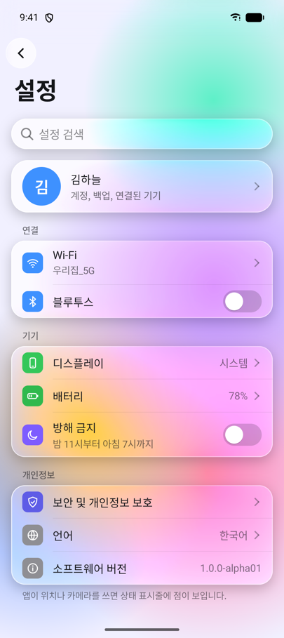<br><b>설정</b><br>섹션 목록과 스위치</td>
  </tr>
</table>

### 폴더블과 태블릿

넓은 화면에서는 메일 목록과 본문이 나란히 놓이고, 음악 플레이어는 앨범 아트 옆에 컨트롤을 둡니다. 아래는 Pixel 9 Pro Fold 에뮬레이터를 펼친 상태로 찍었습니다.

<table>
  <tr>
    <td align="center" width="50%">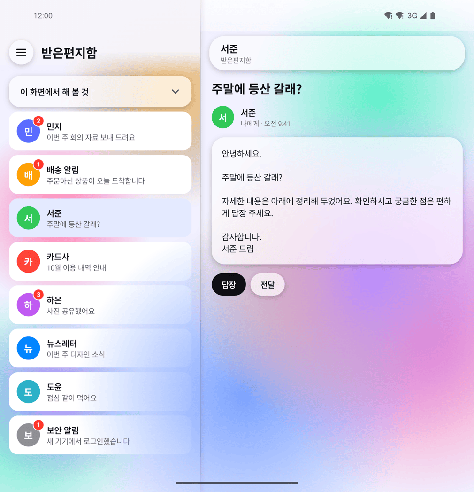<br><b>메일</b><br>왼쪽에 목록, 오른쪽에 본문</td>
    <td align="center" width="50%">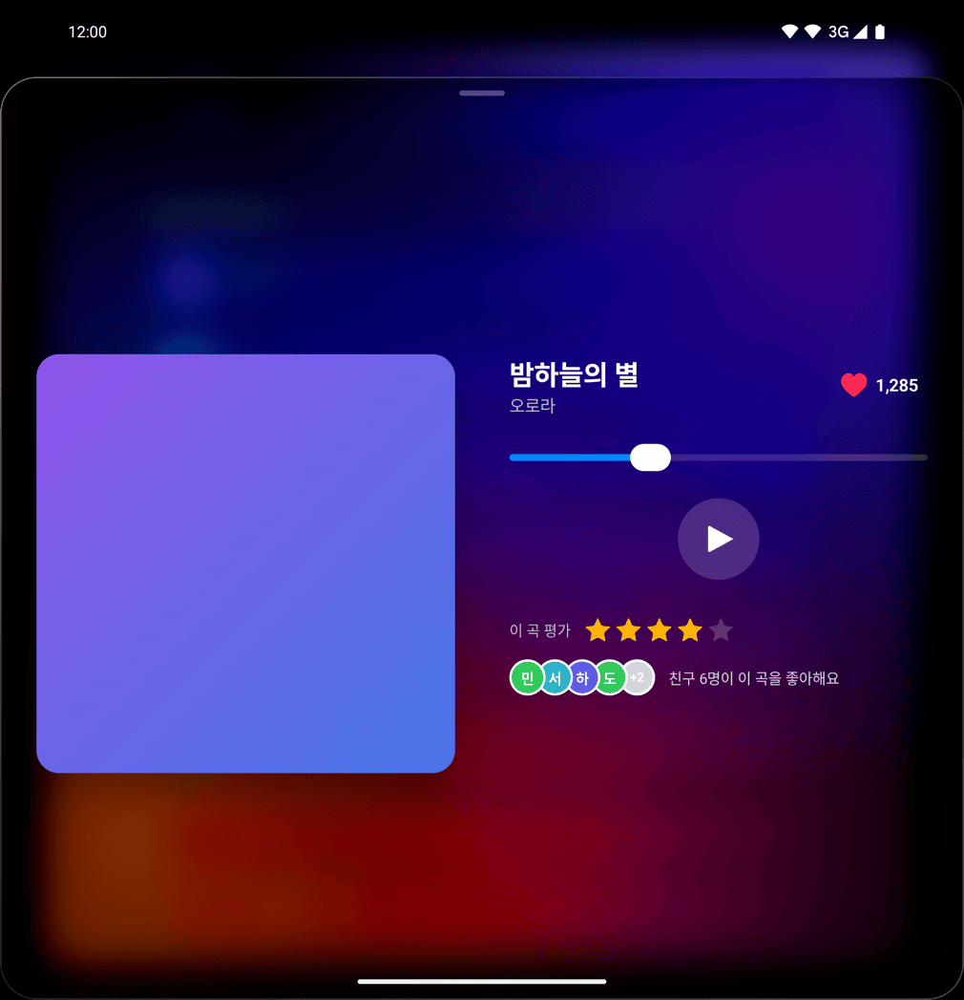<br><b>음악 플레이어</b><br>앨범 아트와 컨트롤을 나란히</td>
  </tr>
</table>

## 샘플 앱

설치해서 바로 만져 볼 수 있는 샘플 앱을 [Releases](https://github.com/Naury74/Kinetica-Kit-SDK/releases/latest)에 올려 두었습니다.

- [샘플 앱 내려받기 (kinetica-showcase.apk)](https://github.com/Naury74/Kinetica-Kit-SDK/releases/latest/download/kinetica-showcase.apk)
- Android 8.0(API 26) 이상에서 설치됩니다. 처음 설치할 때는 "출처를 알 수 없는 앱" 설치를 허용해야 합니다.
- 체험용 키로 서명했습니다. 새 버전이 덮어 설치되지 않으면 이전 샘플 앱을 지우고 다시 설치하세요.

첫 화면의 **UI 키트**에서 컴포넌트, 앱 예제, 모션, 화면 전환 데모를 둘러볼 수 있습니다. 아래쪽 **고급 기능**에는 위젯 보드, 화면 에디터, 서버 드리븐 UI, XML로 만든 화면이 있습니다. 상단 바의 모양 버튼을 누르면 표면과 디자인 언어를 바꿀 수 있고, 바꾼 모양은 모든 데모에 바로 적용됩니다.

## 설치

```kotlin
// settings.gradle.kts
dependencyResolutionManagement {
    repositories {
        google()
        mavenCentral()
    }
}

// app/build.gradle.kts
dependencies {
    implementation("com.naurylab:kinetica-ui:1.0.0-alpha04")
}
```

UI 키트만 쓴다면 `kinetica-ui` 하나면 충분합니다. 위젯 보드나 화면 에디터가 필요할 때만 해당 모듈을 더하세요. 모든 모듈은 같은 버전을 씁니다.

| 모듈 | 용도 |
| --- | --- |
| `kinetica-ui` | UI 키트 전부. 컴포넌트, 표면 스타일, 디자인 언어, 모션, 영상 통화 화면 |
| `kinetica-render-compose` | 아무 컴포저블에나 누름, 등장, 반복 효과를 붙이는 `Modifier.kineticaEffects`, XML View용 `ViewEffects` |
| `kinetica-presets` | 바로 쓰는 효과 프리셋 `EffectPresets` |
| `kinetica-board-compose` | 위젯 보드 `KineticaBoard`, XML용 `KineticaBoardView` |
| `kinetica-player-compose` | 애니메이션 플레이어 `KineticaPlayer`, 서버 드리븐 UI `RemoteKineticaPlayer` |
| `kinetica-editor-compose` | 화면 에디터 `KineticaEditor` |
| `kinetica-serialization` | 화면 JSON 읽기와 쓰기, 서버에서 받아 오기 |
| `kinetica-export-android` | 화면을 PNG로 저장 |
| `kinetica-java` | Java에서 부르는 진입점 |

`kinetica-core`, `kinetica-history`, `kinetica-motion`, `kinetica-guides`, `kinetica-gestures`는 위 모듈이 알아서 가져오는 내부 모듈입니다. 직접 추가할 필요는 없습니다. 모듈 사이의 관계는 [아키텍처](docs/architecture.md) 문서에 있습니다.

- minSdk 26(Android 8.0), Java 17, Kotlin 2.2 이상에서 씁니다. Compose BOM은 2026.09 이상을 권장합니다.
- `kinetica-ui`는 Material 3에 의존하지 않습니다. Material 3 앱에 함께 넣어도 됩니다.
- 따로 R8 규칙을 넣지 않아도 됩니다. 배포한 라이브러리를 R8을 켠 release 앱으로 빌드해 확인하고 있습니다.

## 사용법

### 테마와 표면

화면 맨 바깥을 `KineticaTheme`으로 감싸고 표면 스타일을 정합니다. 그 안에서 쓰는 컴포넌트는 모두 이 모양을 따릅니다.

```kotlin
setContent {
    val dark = isSystemInDarkTheme()
    KineticaTheme(
        // 단색 표면. 글래스는 SurfaceStyles.Liquid, 톤은 SurfaceStyles.tonal(brandColor)
        surface = if (dark) SurfaceStyles.CleanDark else SurfaceStyles.CleanLight,
        colors = KineticaColors(accent = Color(0xFF3B5BDB)),
        design = KineticaDesigns.Material,
    ) {
        var sharing by remember { mutableStateOf(false) }
        KineticaScaffold { padding ->
            Column(Modifier.padding(padding).padding(24.dp)) {
                KButton("공유하기", onClick = { sharing = true }, fullWidth = true)
            }
            KSheet(sharing, onDismissRequest = { sharing = false }) {
                KListItem("링크 복사", onClick = { sharing = false })
                KListItem("메시지로 보내기", onClick = { sharing = false })
            }
        }
    }
}
```

| 원하는 느낌 | `surface` 값 | 블러 |
| --- | --- | --- |
| 뒤가 비치는 글래스 | `SurfaceStyles.Liquid`, `LiquidDark`, `Acrylic`, `OneUiGlass`, `Vision`, `Frosted`, `Mica` 등 15종 | Android 12 이상에서만 보이고, 그 아래에서는 반투명한 색으로 그립니다 |
| 깔끔한 단색 | `SurfaceStyles.CleanLight`, `CleanDark`, `OneUi`, `OneUiDark`, `Material`, `MaterialDark`, 직접 만드는 `SurfaceStyle.Solid(…)` | 없음. 모든 버전에서 똑같이 보입니다 |
| 브랜드 색을 입힌 톤 | `SurfaceStyles.tonal(brandColor, dark)`, `Tonal`, `TonalDark` | 없음 |

버튼, 칩, 카드는 표면과 별개로 모양(`KVariant`: `Filled`, `Tonal`, `Outlined`, `Text`, `Elevated`, `Glass`)과 색(`KTone`: `Accent`, `Neutral`, `Destructive`, `Positive`)을 고를 수 있습니다.
이미 Material 3를 쓰는 앱이라면 `MaterialTheme` 안에 `KineticaTheme`을 두고 강조색과 글꼴만 넘기면 됩니다. 자세한 방법은 [빠른 시작](docs/36-quick-start.md)에 있습니다.

### 다이얼로그와 토스트

```kotlin
val toast = rememberKToastState()
val scope = rememberCoroutineScope()
var confirm by remember { mutableStateOf(false) }

KAlertDialog(
    visible = confirm,
    onDismissRequest = { confirm = false },
    title = "사진을 삭제할까요?",
    message = "삭제한 사진은 되돌릴 수 없습니다.",
    actions = listOf(
        KDialogAction("취소"),
        KDialogAction("삭제", KDialogActionStyle.Destructive) {
            scope.launch { toast.show("삭제했어요") }
        },
    ),
)
KToastHost(toast)
```

`KineticaScaffold` 밖에서 불러도 됩니다. 이때는 다이얼로그와 시트, 토스트가 각자 창을 띄우므로, Material `Scaffold`를 쓰는 화면에서도 그대로 동작합니다.

### XML 화면

```kotlin
val handle = KSheets.show(activity, R.layout.share_sheet)
KToasts.show(activity, "저장했어요")
```

레이아웃에 `KSurfaceView`를 넣고 `app:kinetica_surfaceStyle`을 지정하면 그 자리가 글래스나 단색 표면이 됩니다. 누를 때 효과는 `kinetica-render-compose`의 `ViewEffects.apply`로 붙입니다. 자세한 내용은 [UI 키트](docs/35-ui-kit.md)와 [모션 효과](docs/33-effects.md) 문서를 보세요.

### 위젯 보드

```kotlin
val catalog = listOf(BoardWidget("sales", "오늘 매출", widthDp = 176f, heightDp = 120f), BoardWidget("orders", "최근 주문"))

setContent {
    // 화면을 회전해도 배치와 실행 취소 기록이 남고, 화면이 가려질 때마다 저장된다.
    val board = rememberKineticaBoardState(catalog, BoardStorage.sharedPreferences(this, "home", "board"))
    var editing by rememberSaveable { mutableStateOf(false) }
    KineticaBoard(board, Modifier.fillMaxSize(), editing = editing, onLongPress = { editing = true }) { id ->
        when (board.widgetKeyOf(id)) {
            "sales" -> SalesCard()     // 호스트의 Composable을 그대로 쓴다
            "orders" -> OrdersCard()
        }
    }
}
```

위젯은 앱이 가진 컴포저블을 그대로 씁니다. 편집 중에 위젯을 위로 끌면 Windows의 스냅 레이아웃처럼 배치를 고를 수 있고, 다른 위젯 위에 놓으면 스택으로 묶입니다. 자세한 내용은 [위젯 보드](docs/31-board.md) 문서에 있습니다.

### 애니메이션 플레이어와 서버 드리븐 UI

```kotlin
val box = SceneNode(NodeId("box"), NodeContent.Rectangle(Size(400.0, 400.0)), style = NodeStyle(fill = ArgbColor(0xFF7C8CFF.toInt())))
val fade = Timeline("main", 1_000, listOf(PropertyTrack(box.id, AnimatableProperty.Opacity,
    listOf(Keyframe(0, KeyValue.Scalar(0.0)), Keyframe(1_000, KeyValue.Scalar(1.0))))))
val scene = SceneDocument("hello", Artboard(1080.0, 1920.0), mapOf(box.id to box), listOf(box.id), listOf(fade))

setContent {
    val playback = rememberPlaybackController(fade)
    LaunchedEffect(playback) { playback.play() }   // 재구성할 때마다 호출되지 않도록 effect 안에서 시작한다
    KineticaPlayer(scene, Modifier.fillMaxSize(), playback)
}
```

서버에서 받은 JSON을 띄울 때는 `RemoteKineticaPlayer`를 씁니다. 받아 온 화면은 캐시에 남고, 서명을 확인할 수 있고, 여러 화면을 한 번에 묶어 받을 수도 있습니다. 받기에 실패하면 지금 보이는 화면을 그대로 둡니다. 화면 에디터, 앱의 실제 뷰와 실시간 데이터 넣기, PNG 저장, Java에서 쓰기는 [연동 예](docs/integration.md)에 정리했습니다.

## 주의사항

- 글래스 블러는 Android 12(API 31) 이상에서만 보입니다. 그보다 낮은 기기에서는 반투명한 색으로 대신 그립니다. 단색과 톤은 버전과 상관없이 똑같습니다.
- 글래스는 단색보다 GPU를 더 씁니다. 펼친 폴더블이나 태블릿처럼 화면이 큰 기기에서 시트를 자주 여는 화면이라면 단색이나 톤도 함께 고려해 보세요. 실제 측정값은 [성능](docs/performance.md) 문서에 있습니다.
- 물결 왜곡과 메시 그라디언트는 Android 13(API 33) 이상에서 셰이더로 그리고, 그 아래에서는 비슷한 모양으로 대신 그립니다.
- XML 화면에서 써도 앱에는 Compose 런타임이 포함됩니다.
- 컴포넌트 문구는 13개 언어로 나옵니다. 앱이 지원하는 언어가 더 적으면 앱 모듈의 `androidResources.localeFilters`로 앱 언어만 남기세요. 그래야 한 화면에 두 언어가 섞이지 않습니다. 자세한 내용은 [UI 키트](docs/35-ui-kit.md#언어) 문서에 있습니다.
- SDK는 네트워크 권한을 쓰지 않고 아무것도 밖으로 보내지 않습니다. 서버 드리븐 UI도 앱이 받아 온 데이터를 검증한 뒤 읽기만 합니다. 자세한 내용은 [SECURITY.md](SECURITY.md)에 있습니다.

## 문서

| 문서 | 내용 |
| --- | --- |
| [빠른 시작](docs/36-quick-start.md) | 설치, 기존 테마와 맞추기, 자주 쓰는 예, 흔한 실수, 테스트 |
| [UI 키트](docs/35-ui-kit.md) | 표면 스타일과 전체 컴포넌트, 앱에 넣을 때 알아 둘 점, 성능 |
| [모션 효과](docs/33-effects.md) | `kineticaEffects`, `ViewEffects`, 프리셋, 화면 전환 |
| [위젯 보드](docs/31-board.md) | 보드 붙이기, 편집 동작, 저장, 넓은 화면 |
| [UI 조립](docs/30-ui-composer.md) | 앱 뷰 슬롯, 데이터 바인딩, 오토 레이아웃, 컴포넌트, 서버 드리븐 UI |
| [화면 에디터](docs/32-studio.md) | 편집 기능, 도형과 스타일, 리치 텍스트, 타임라인 |
| [화면 JSON](docs/34-scene-json.md) | 서버에서 내려주는 화면과 저장 파일의 형식 |
| [연동 예](docs/integration.md) | 에디터 세션, 이미지, 서버 드리븐 UI, XML, PNG 저장, 화면 전환, Java |
| [아키텍처](docs/architecture.md), [성능](docs/performance.md), [검증 가이드](docs/evaluation.md) | 모듈 구조, 측정값, 기능을 하나씩 확인하는 순서와 알려진 제한 |
| [변경 이력](CHANGELOG.md) | 버전마다 바뀐 내용 |

빌드와 기여 방법은 [CONTRIBUTING](CONTRIBUTING.md), 배포 절차는 [docs/publishing.md](docs/publishing.md)에 있습니다.

## License

Apache License 2.0으로 배포합니다. 자세한 내용은 [LICENSE](LICENSE)를 보세요.
