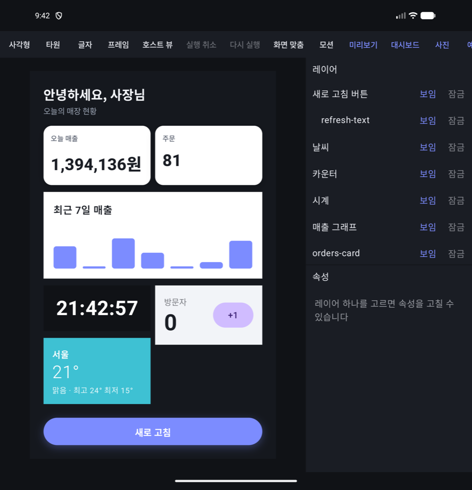
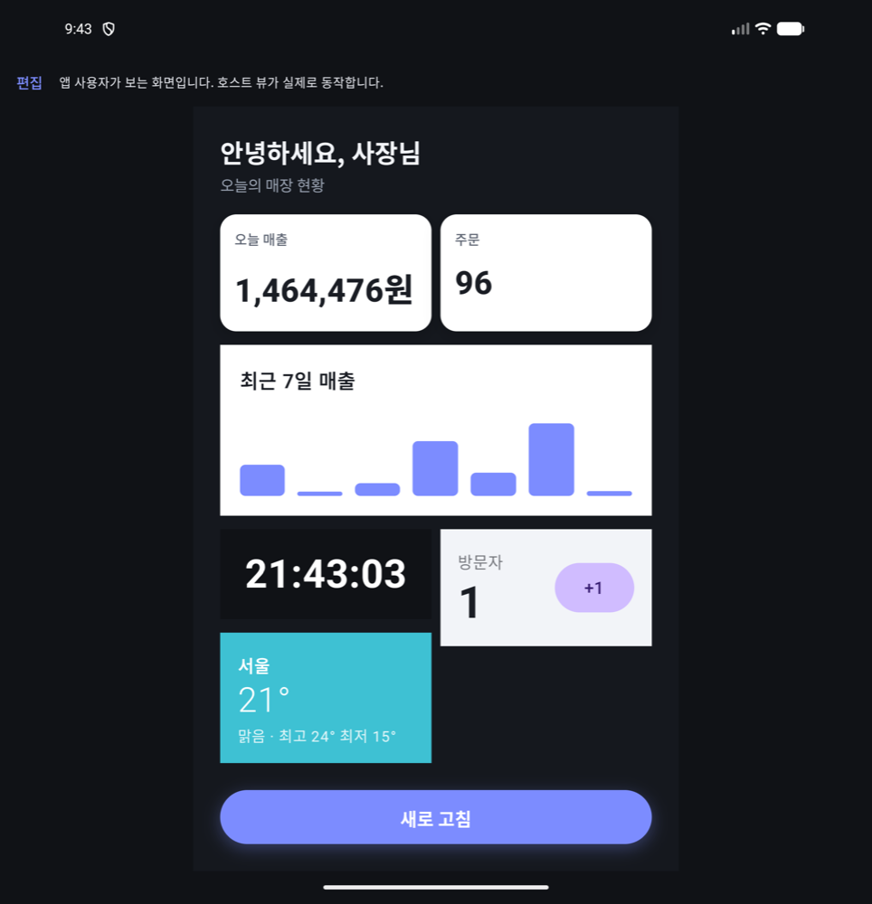
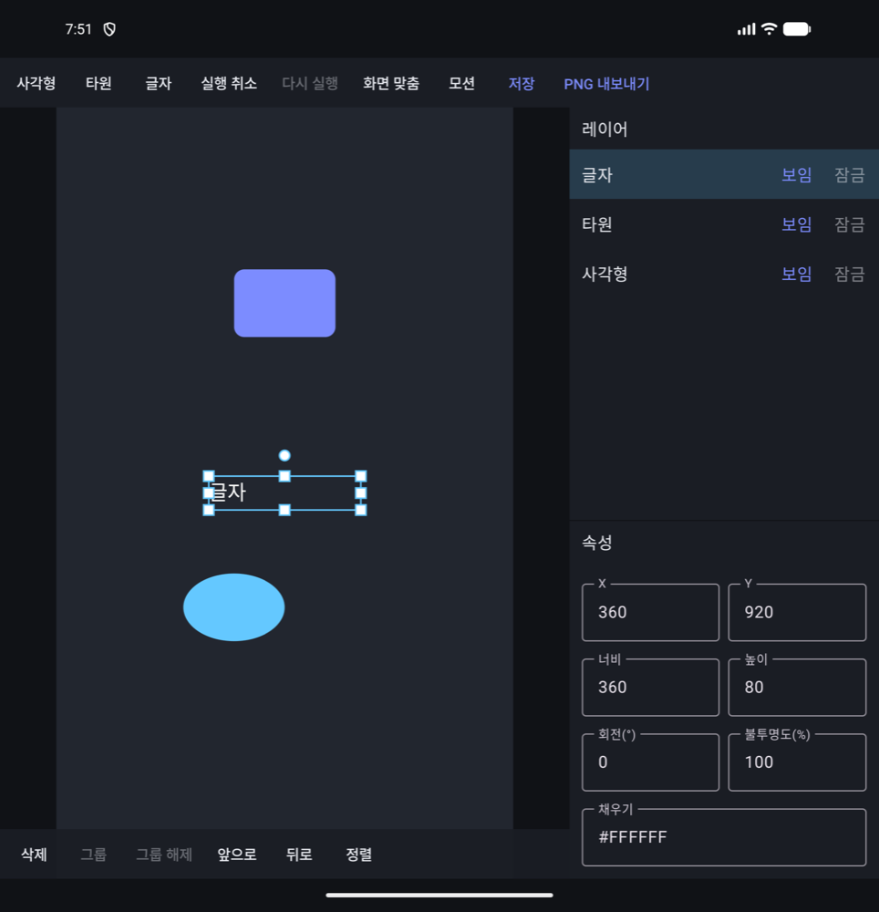
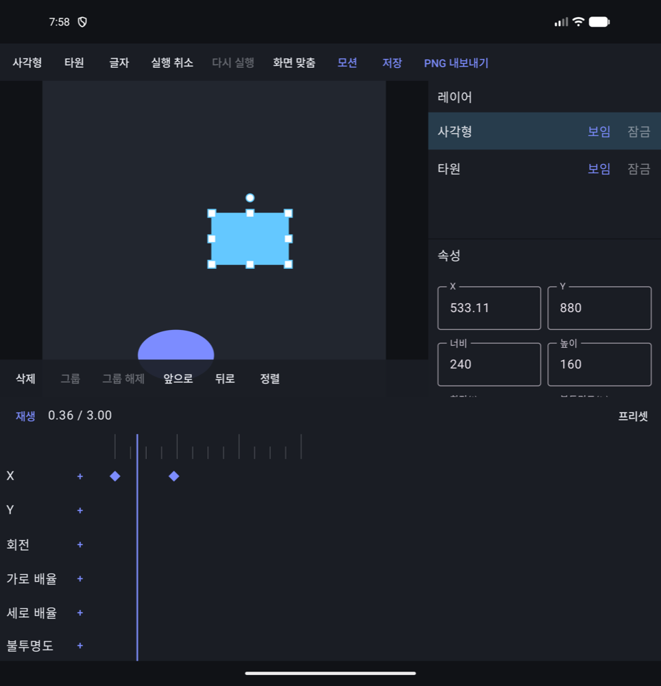
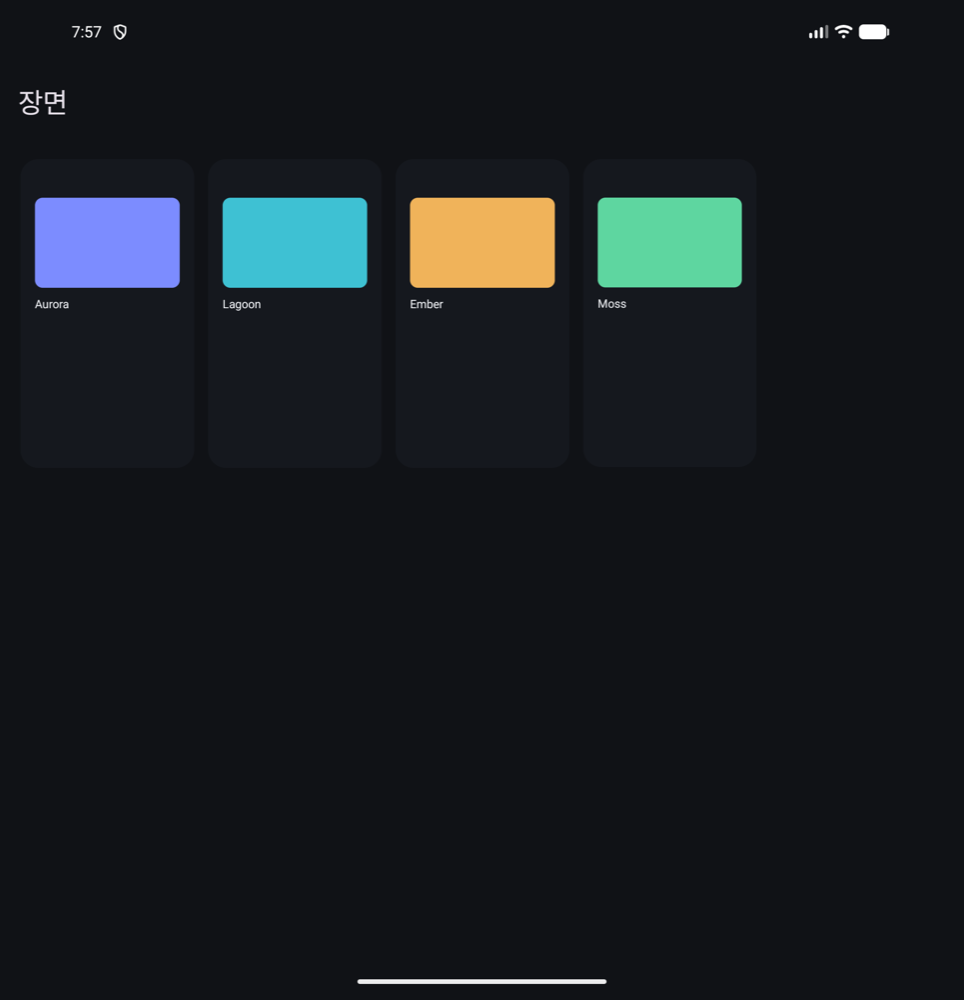
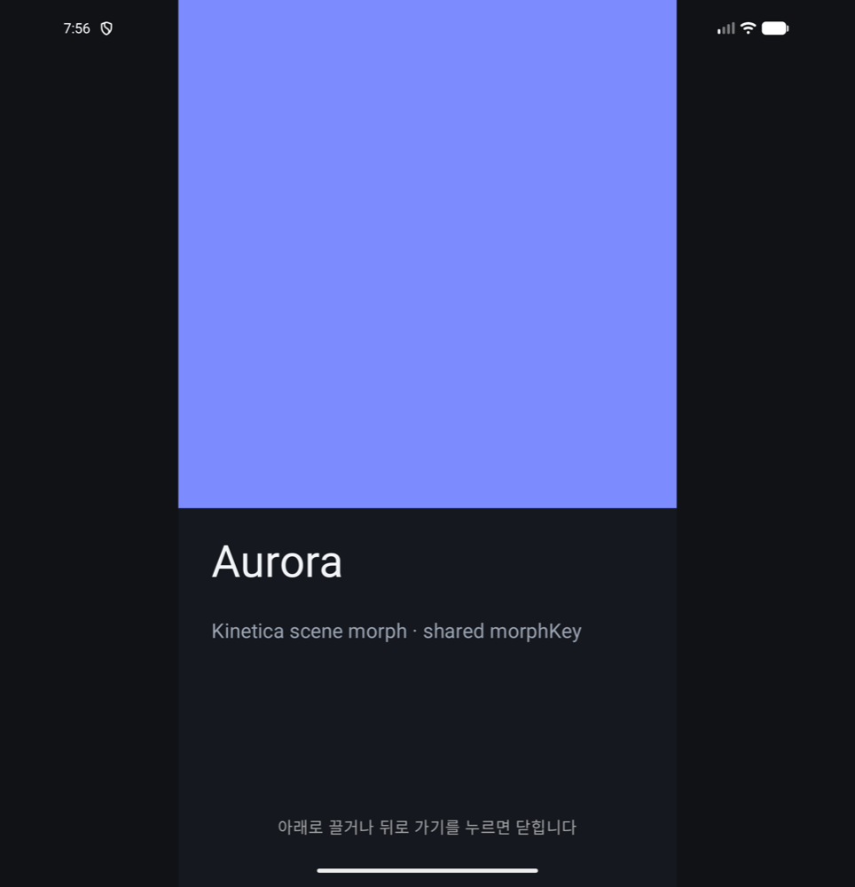

# Kinetica

> **WIP**: 아직 배포 전입니다. Maven Central에 올라가 있지 않고, 공개 API는 0.x 동안 바뀔 수 있습니다.

**Kinetica**는 호스트 앱의 실제 화면 조각(Compose 뷰)과 데이터를 받아, 앱 운영자나 사용자가 그것을 **자유롭게 배치·꾸미는 화면 편집기와 재생기**를 앱 안에 넣는 Android SDK입니다.
호스트 뷰는 편집 중에도 살아 있고, 글자·보임·이미지·색은 호스트 데이터 키에 묶여 실시간으로 바뀌며, 누르면 동작 이름이 호스트로 돌아옵니다.
그 아래에는 정밀하게 편집할 수 있는 2D 장면(scene graph), 시간 기반 애니메이션, 장면 전환이 있습니다. 방향과 단계는 [ADR-0006](docs/adr/0006-host-ui-composer.md)과 [UI 조립 계획](docs/30-ui-composer.md)을 보세요.

- **Board**: 호스트 화면에 넣는 위젯 보드 `KineticaBoard`·`KineticaBoardView`(XML). 사용자가 앱 안에서 바로 옮기고·크기 바꾸고·빼고·추가, 가장자리로 끌면 반·4분의 1·전체 분할, 격자 배치, 같은 위젯 여러 개(메모 등), 위젯 묶음(한 자리에서 넘겨 보기), 길게 눌러 편집·자동 스크롤·키보드·TalkBack, 저장·앱 업데이트 맞춤([docs/31](docs/31-board.md))
- **Host UI**: `slots`(키 → Compose 뷰)·`hostViews`(편집기 메뉴)·`SceneData`(실시간 값)·`onAction`(누름)

- **Studio**: 캔버스·도구·레이어·속성·timeline이 있는 편집 화면 `KineticaEditor`
- **Player**: 편집 의존성 없이 장면을 재생하는 `KineticaPlayer`, 서버가 내려준 화면을 재생하는 `RemoteKineticaPlayer`
- **Transitions**: 같은 `morphKey` 노드를 잇는 장면 morph, 끌어서 닫기, Compose 공유 전환 연결
- **Headless**: Android 없이 쓰는 문서·좌표·keyframe 평가(Kotlin JVM)

<table>
  <tr>
    <td align="center" width="50%"><br><b>Host UI 편집</b><br>호스트 위젯·실시간 데이터를 자유 배치</td>
    <td align="center" width="50%"><br><b>사용자 화면</b><br>위젯이 실제로 동작하고 동작은 호스트로</td>
  </tr>
</table>

<table>
  <tr>
    <td align="center" width="25%"><br><b>Studio</b><br>레이어·속성 패널</td>
    <td align="center" width="25%"><br><b>Motion</b><br>재생 위치 기준 자동 키</td>
    <td align="center" width="25%"><br><b>Gallery</b><br>재생기만 쓰는 앱</td>
    <td align="center" width="25%"><br><b>Transition</b><br>morphKey 장면 morph</td>
  </tr>
</table>

화면은 `sample-studio`·`sample-gallery` debug 빌드를 Android 에뮬레이터(펼친 폴더블, 한국어)에서 실행한 실제 화면입니다.

## 지금 되는 것 (0.1.0-SNAPSHOT)

- **디자인**: 사각형·타원·다각형·별·선·화살표, 단색·선형·원형 그라디언트, 바깥·안쪽 그림자 여러 개(퍼짐), 레이어 흐림, 점선, 모서리별 반지름, 리치 텍스트(구간별 굵기·기울임·밑줄·크기·색·글꼴, 호스트 글꼴), 기기 틀 목업 PNG([docs/32](docs/32-studio.md))
- **자동 배치·화면 크기 대응**: Frame 가로·세로 자동 배치(간격·여백·정렬·늘이기·내용 맞춤·남는 공간 채우기·줄 바꿈), 크기 최소·최대, 글자에 맞춘 상자(높이·너비 자동), 끌어서 자동 배치 안 순서 바꾸기, 고른 노드를 자동 배치로 감싸기, 노드 제약(왼쪽·오른쪽·좌우·가운데·비율), 재생기 `SceneFit.Responsive`로 기기 화면 모양에 맞춰 펼치기
- **컴포넌트·디자인 토큰**: Frame을 컴포넌트로 만들고 인스턴스를 넣으면 원본을 고칠 때 함께 바뀜(인스턴스에서 바꾼 값은 유지·되돌리기·분리), 색 토큰에 채우기·선을 이어 토큰 하나로 전체 색 바꾸기, 변형(`세트/변형` 이름, 인스턴스에서 고르거나 호스트 데이터로 선택), 기본 키트(버튼 세트·칩·카드·토글·입력·목록 항목·탭 바)
- **움직임 효과**: 호스트의 Compose 뷰(`Modifier.kineticaEffects`)·XML View(`ViewEffects.apply`)·장면 노드·보드 위젯에 한 줄로 붙이는 리플·눌림·기울기·어둡게·떠오르기·터지기, 나타나기 9종, 반복 11종(두근·둥실·반짝임·빛 번짐·콩닥·퍼지는 고리 등)과 묶음 `EffectPresets`, 화면 전환 `ContentTransitions`, 숫자 올라가기 `animateNumberAsState`. 클릭을 가로채지 않고 "애니메이션 줄이기"를 따른다([docs/33](docs/33-effects.md))
- **서버 주도 화면**: 호스트가 받은 장면 JSON을 같은 검증으로 읽어 재생(`RemoteSceneLoader`·`RemoteKineticaPlayer`). 캐시·앱에 넣은 기본 문서·etag(다시 켜도 유지)·서명 확인(`SceneVerifier`)·여러 화면 묶음(`RemoteSceneBundleLoader`), 실패하거나 호스트가 거절하면 지금 화면 유지. 배치가 바뀌어도 호스트 뷰 상태·데이터·동작은 이어짐
- **호스트 UI 조립**: 호스트 뷰 자리(HostSlot)·Frame(모서리·자르기)·그림자·글자 굵기, 데이터 바인딩(글자·보임·이미지·채우기·불투명도), 탭 동작, 노드마다 실제 Compose 요소로 그리는 `SceneLayout`, 글자를 두 번 눌러 바로 고치기
- **문서**: 그룹·Frame·사각형·타원·다각형·경로·글자·이미지·호스트 뷰 노드, 불변 문서, 명령으로만 수정, 모든 결과를 검증(id·순환·깊이·유한값·상한·URI)
- **편집**: 고르기·옮기기·크기·회전(회전·중첩된 노드에서도 반대쪽 손잡이 고정), 사각 선택, 두 손가락 이동·확대, 안내선 스냅(8dp/12dp hysteresis), 그룹·그룹 해제(화면 위치 유지), 정렬·분배, 순서, 속성·레이어 패널, 키보드 단축키
- **실행 취소**: 제스처 하나가 한 단계, 바뀐 노드만 담는 기록, 단계 수·메모리 상한
- **모션**: keyframe(이동·배율·회전·불투명도·색·선 두께·너비·높이·모서리·선 색·흐림·그림자 흐림·X·Y·퍼짐·색·모서리별 반지름·그라디언트 색·각도), easing(Bezier·steps·용수철), 시계 기준 재생(배속·반복·왕복·역방향·marker·동작 줄이기), timeline 편집 화면, 재생 위치 기준 자동 키, 프리셋 6종
- **전환**: 장면 morph(같은 종류는 보간, 다른 종류는 dissolve), 끌어서 닫기(속도 반영, 끝 알림 한 번), Compose `sharedBounds` 연결
- **이미지**: 사진 선택기로 고른 `content://` 이미지를 크기 제한해 읽는 기본 로더(호스트가 따로 줄 수도 있음)
- **저장·내보내기**: 형식 버전이 있는 JSON(크기·중첩 상한, migration 틀), 원자적 교체로 저장하는 파일 저장소, 화면과 같은 그리기로 PNG 내보내기
- **샘플**: `sample-board`(평범한 가게 앱 홈 화면에서 길게 눌러 편집·자유/격자 배치·XML 화면), `sample-studio`(편집·저장·내보내기, **대시보드** 예제의 호스트 위젯·실시간 데이터·**미리보기**), `sample-gallery`(재생기만 쓰는 장면 전환, View 화면 연결, 가짜 서버로 바꾸는 **서버 화면**)

아직 없는 것과 제한은 [알려진 제한](#알려진-제한)을 보세요.

## 요구 사항

- minSdk 26, Java 17. 라이브러리는 compileSdk 37·Kotlin 2.4·Compose BOM 2026.09·AGP 9.4로 빌드합니다.
  호스트 앱도 Kotlin 2.4 이상, 같은 Compose BOM 이상을 권장합니다(그보다 낮으면 Kotlin 메타데이터·Compose 바이너리가 맞지 않을 수 있음).
- 보드·재생기·편집기는 Compose를 씁니다. XML View 화면은 `KineticaBoardView`·`ViewEffects`로 Compose 코드 없이 씁니다(앱에 Compose 런타임은 들어감).
- 스레드: 상태 객체(`KineticaBoardState`, `KineticaSession`)는 메인 스레드에서 씁니다. `RemoteSceneLoader`·`SceneRepository`는 suspend 함수이며 어느 스레드에서 불러도 됩니다.

## 연동

배포 전이라 지금은 `./gradlew publishToMavenLocal`로 로컬 저장소에 올려 씁니다. 좌표는 `com.naurylab:<모듈>:0.1.0-SNAPSHOT`입니다.

```kotlin
dependencies {
    implementation("com.naurylab:kinetica-board-compose:0.1.0-SNAPSHOT")    // 호스트 위젯 자유 배치 보드(대시보드)
    implementation("com.naurylab:kinetica-render-compose:0.1.0-SNAPSHOT")   // 움직임 효과·화면 전환·숫자 올라가기만
    implementation("com.naurylab:kinetica-presets:0.1.0-SNAPSHOT")          // EffectPresets·UiKit(선택)
    implementation("com.naurylab:kinetica-player-compose:0.1.0-SNAPSHOT")   // 장면 재생·서버 화면
    implementation("com.naurylab:kinetica-editor-compose:0.1.0-SNAPSHOT")   // 편집 화면(선택)
    implementation("com.naurylab:kinetica-serialization:0.1.0-SNAPSHOT")    // JSON·파일 저장(선택)
    implementation("com.naurylab:kinetica-export-android:0.1.0-SNAPSHOT")   // PNG 내보내기(선택)
}
```

보드(호스트 위젯을 사용자가 배치):

```kotlin
val catalog = listOf(BoardWidget("sales", "오늘 매출", widthDp = 176f, heightDp = 120f), BoardWidget("orders", "최근 주문"))

setContent {
    // 화면을 돌려도 배치·실행 취소가 남고, 화면이 가려질 때마다 저장된다.
    val board = rememberKineticaBoardState(catalog, BoardStorage.sharedPreferences(this, "home", "board"))
    var editing by rememberSaveable { mutableStateOf(false) }
    KineticaBoard(board, Modifier.fillMaxSize(), editing = editing, onLongPress = { editing = true }) { id ->
        when (board.widgetKeyOf(id)) {
            "sales" -> SalesCard()     // 호스트 Composable 그대로
            "orders" -> OrdersCard()
        }
    }
}
```

재생기:

```kotlin
val box = SceneNode(NodeId("box"), NodeContent.Rectangle(Size(400.0, 400.0)), style = NodeStyle(fill = ArgbColor(0xFF7C8CFF.toInt())))
val fade = Timeline("main", 1_000, listOf(PropertyTrack(box.id, AnimatableProperty.Opacity,
    listOf(Keyframe(0, KeyValue.Scalar(0.0)), Keyframe(1_000, KeyValue.Scalar(1.0))))))
val scene = SceneDocument("hello", Artboard(1080.0, 1920.0), mapOf(box.id to box), listOf(box.id), listOf(fade))

setContent {
    val playback = rememberPlaybackController(fade)
    LaunchedEffect(playback) { playback.play() }   // 구성할 때마다 부르지 않도록 효과 안에서 시작한다
    KineticaPlayer(scene, Modifier.fillMaxSize(), playback)
}
```

편집기와 저장:

```kotlin
val repository = FileSceneRepository(File(filesDir, "scenes"))

lifecycleScope.launch {   // load는 suspend 함수다
    val document = (repository.load("studio") as? LoadResult.Loaded)?.document ?: SceneDocument.empty(Artboard(1080.0, 1920.0))
    val session = (KineticaSession.create(document) as SessionOpenResult.Opened).session
    setContent {
        val scope = rememberCoroutineScope()
        KineticaEditor(session, Modifier.fillMaxSize(), toolbarEnd = {
            TextButton(onClick = { scope.launch { repository.save("studio", session.document.value) } }) { Text("저장") }
        })
    }
}
```

호스트 뷰와 실시간 데이터:

```kotlin
val slots: SceneSlots = mapOf("widget.sales_chart" to { SalesChart(sales) })   // 호스트 것 그대로
val hostViews = listOf(HostViewOption("widget.sales_chart", "매출 그래프", 900.0, 360.0))
val data = SceneData.of("sales.today" to DataValue.Text("1,284,000원"))           // 글자 노드의 Text 바인딩 키

KineticaEditor(session, slots = slots, hostViews = hostViews, data = data)        // 운영자·사용자가 배치
KineticaPlayer(document, slots = slots, data = data, fit = SceneFit.Responsive, onAction = { action -> /* "refresh" 등 */ })
```

서버 화면 JSON 형식은 [docs/34](docs/34-scene-json.md), 받기(OkHttp·ETag)·XML 재생기는 [docs/integration.md](docs/integration.md)에 있습니다.

세션은 화면 회전에도 유지되도록 ViewModel에 두고, 화면을 닫을 때 `session.close()`를 부릅니다. View 화면·Java·내보내기·전환은 [docs/integration.md](docs/integration.md)를 보세요.

## 모듈

| 모듈 | 종류 | 내용 |
| --- | --- | --- |
| `kinetica-core` | Kotlin JVM | 장면 문서·노드, 행렬·viewport, 명령·reducer, 검증, hit test, 변형 계산 |
| `kinetica-history` | Kotlin JVM | `KineticaSession`, 트랜잭션, 실행 취소 |
| `kinetica-motion` | Kotlin JVM | keyframe 평가, easing, 재생 제어, 장면 morph, 전환 진행률 |
| `kinetica-guides` | Kotlin JVM | 안내선 스냅 |
| `kinetica-presets` | Kotlin JVM | 모션 프리셋, 기본 컴포넌트 키트(`UiKit`), 움직임 효과 묶음(`EffectPresets`) |
| `kinetica-serialization` | Kotlin JVM | JSON 읽기·쓰기, migration, 파일 저장소, 서버 문서 받기(`RemoteSceneLoader`) |
| `kinetica-java` | Kotlin JVM | Java 호스트용 정적 입구(선택) |
| `kinetica-render-compose` | Android | 장면 그리기(`SceneLayout`·`drawScene`), 움직임 효과(`Modifier.kineticaEffects`·`ViewEffects`) |
| `kinetica-gestures` | Android | 캔버스 포인터 상태 기계 |
| `kinetica-editor-compose` | Android | `KineticaEditor` |
| `kinetica-player-compose` | Android | `KineticaPlayer`·`RemoteKineticaPlayer`, 전환 그리기·끌어서 닫기 |
| `kinetica-board-compose` | Android | 위젯 보드 `KineticaBoard`·`KineticaBoardView` |
| `kinetica-export-android` | Android | PNG 내보내기 |

의존 방향과 데이터 흐름, 좌표계는 [docs/architecture.md](docs/architecture.md)에 있습니다. 기능을 하나씩 확인하는 순서는 [docs/evaluation.md](docs/evaluation.md).

## 보안과 개인정보

- SDK는 네트워크 권한이 없고 문서·이미지·사용 기록을 밖으로 보내지 않습니다. 서버 화면도 받는 일은 호스트의 `SceneFetcher`가 하고, SDK는 받은 바이트를 검증만 합니다. 문서 안의 동작·데이터·호스트 뷰 키는 이름일 뿐 코드를 실행하지 않습니다.
- 외부에서 받은 문서는 크기(기본 10 MiB)·JSON 중첩(64단계)·노드 수·글자 길이·keyframe 수·유한한 숫자·URI scheme을 확인한 뒤에만 문서가 됩니다. 실패해도 예외 대신 이유를 돌려주고, 이유에는 사용자 글자를 담지 않습니다.
- 이미지 노드는 `content://`·`android.resource://`만 기본 허용하며 SDK가 직접 열지 않습니다. 호스트가 `SceneImageProvider`로 미리 읽은 이미지를 줍니다.

자세한 정책은 [SECURITY.md](SECURITY.md)에 있습니다.

## 성능

JVM(Apple M5) 기준으로 노드 2,000개에서 명령 적용 p95 약 0.4 ms, timeline 평가 약 0.14 ms입니다. 실기기(Galaxy Z Fold7 커버 화면, 120Hz, 출시용 빌드)에서 보드 스크롤 프레임 p50 5 ms·p90 7 ms, 편집 중 끌기는 놓친 프레임 6~9%였습니다. 측정 방법과 전체 표는 [docs/performance.md](docs/performance.md).

## 알려진 제한

- API 26·27 실기기 동작은 아직 확인하지 않았습니다(에뮬레이터·Android 16 실기기에서 확인).
- 이미지는 `content://`·`android.resource://`만 읽습니다(웹 URL은 열지 않음). API 26·27에서는 EXIF 회전을 반영하지 않습니다.
- 그룹은 자식을 자르지 않고, 그룹 opacity는 레이어로 합성하지 않고 자식마다 곱합니다(겹친 자식은 더 진하게 보일 수 있음).
- 여러 노드를 한꺼번에 크기 조절·회전할 수 없습니다. 캔버스에서는 최상위 단위로 고릅니다(그룹 안 노드는 레이어 패널에서).
- 회전 보간은 가장 짧은 방향만 지원합니다. timeline 확대·키 여러 개 끌기·그래프 편집기는 없습니다.
- SVG·MP4 내보내기, 협업, 문자 shaping 세부 제어는 범위 밖입니다(docs의 v1.1 이후).
- 오른쪽에서 왼쪽으로 쓰는 언어(RTL): 보드는 화면을 좌우로 뒤집습니다(배치·끌기·추가 버튼·빼기 표시·크기 손잡이). 장면(`SceneLayout`) 좌표는 디자인한 그대로이며 뒤집지 않습니다.
- 기본 제공 글자(편집기·보드 안내)는 영어·한국어만 있습니다. 다른 언어는 같은 이름의 문자열 리소스로 덮어씁니다.
- Android 모듈의 공개 API dump는 AGP 9 내장 Kotlin 제약으로 아직 없습니다([ADR-0005](docs/adr/0005-abi-dumps.md)).

## 빌드

```bash
export JAVA_HOME="/Applications/Android Studio.app/Contents/jbr/Contents/Home"
./gradlew check :sample-studio:assembleDebug :sample-studio:assembleRelease :sample-gallery:assembleRelease
```

`check`는 단위·Robolectric 테스트, Android Lint, ktlint, detekt, 공개 API 검사(`checkKotlinAbi`), gallery release 런타임 검사(`verifyReleaseClasspath`)를 실행합니다.
배포된 artifact만으로 빌드되는지는 `./gradlew publishToMavenLocal && ./gradlew -p consumer-check :app:assembleRelease`로 확인합니다.
기여 방법은 [CONTRIBUTING.md](CONTRIBUTING.md), 변경 내역은 [CHANGELOG.md](CHANGELOG.md), 설계 결정은 [docs/adr](docs/adr).

## 라이선스

[Apache License 2.0](LICENSE)
